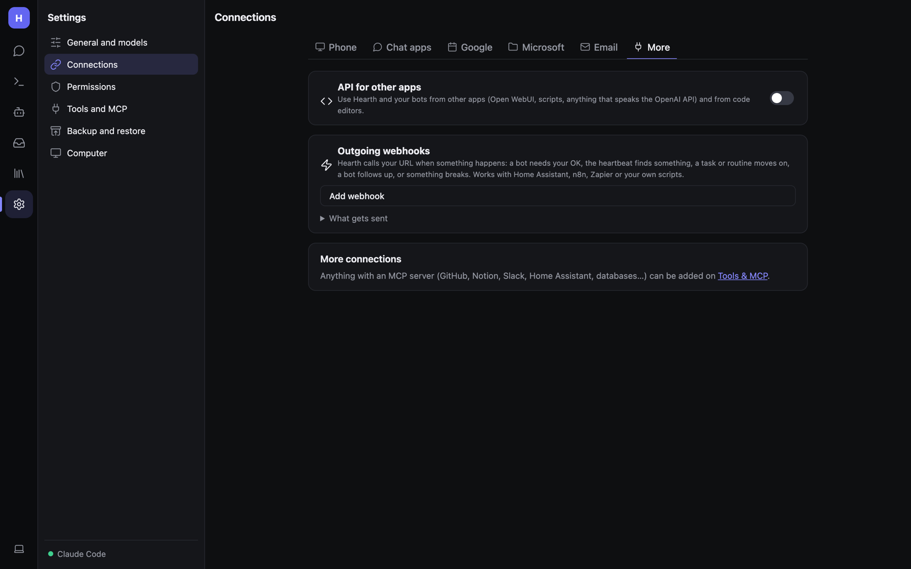

# API and outgoing webhooks

Connect Hearth to other software: other apps can call Hearth (the API, incoming webhooks), and Hearth can call them
(outgoing webhooks). Both are in **Settings → Connections → More**.



## API for other apps (OpenAI-compatible)

Use Hearth and your bots from anything that speaks the OpenAI API: Open WebUI, scripts, n8n, code editors.

1. Turn on **API for other apps**.
2. Copy the **Address** and click **New key** (keys look like `hearth-…`). Store the key safely.

Endpoints (web host):

| Endpoint | Does |
|---|---|
| `GET /v1/models` | Lists `hearth` (plain Hearth) and `hearth/<bot>` for each bot, e.g. `hearth/researcher` |
| `POST /v1/chat/completions` | Chat, streaming (`"stream": true`) or not |

Every call needs `Authorization: Bearer <key>`; a missing or wrong key gets **401**. The API is off until you turn it
on.

```bash
curl http://localhost:5290/v1/chat/completions \
  -H "Authorization: Bearer hearth-…" \
  -H "Content-Type: application/json" \
  -d '{"model":"hearth/researcher","messages":[{"role":"user","content":"What changed in .NET 10?"}]}'
```

Each request is a fresh run as that bot, with its instructions, memory, skills and tools. Nobody is there to approve
things, so tools that need approval don't run, and no chat is kept. Token counts in the response are reported as 0;
see the [Usage](Admin-Monitoring.md) page for real numbers.

### From a code editor (Zed and other ACP editors)

The installer puts an editor bridge at `~/.hearth/acp/hearth-acp.dll`. In Zed's `settings.json`:

```json
"agent_servers": {
  "Hearth": {
    "command": "dotnet",
    "args": ["/Users/you/.hearth/acp/hearth-acp.dll"],
    "env": {
      "HEARTH_URL": "http://localhost:5290",
      "HEARTH_API_KEY": "(your key)",
      "HEARTH_MODEL": "hearth/engineer"
    }
  }
}
```

The card shows this with your real address and an *Engineer* bot filled in, plus a ready-made `curl` under **Try it
from a terminal**.

## Incoming webhooks (routine triggers)

Each webhook routine has its own URL: `POST /hooks/{routineId}?token=SECRET` (or the header `X-Hearth-Token`). The
body is passed to the bot. Wrong secret → **403**. See
[Routines and triggers](Routines-and-Triggers.md#webhooks-in-detail).

## Outgoing webhooks

Hearth calls your URL when something happens. Works with Home Assistant, n8n, Zapier or your own scripts.

1. **Add webhook** and enter the URL.
2. Tick the events to send:

   | Event key | When |
   |---|---|
   | `approval` | A bot needs your OK |
   | `heartbeat` | The heartbeat found something |
   | `task` | Task milestones (plan, question, done, failed) |
   | `routine` | A routine finished |
   | `follow_up` | A bot followed up |
   | `problem` | Something went wrong |

3. Optionally set a **signing secret**.
4. **Send test**. The card shows the last result.

What's sent:

```
POST your-url
Content-Type: application/json
X-Hearth-Event: task
X-Hearth-Signature: sha256=<hex HMAC-SHA256 of the body, with your secret>   (only if a secret is set)

{ "event": "task", "title": "Task: …", "text": "🏁 Done: …", "conversationId": "…",
  "link": "https://…/c/…", "at": "2026-11-05T09:30:00-05:00", "taskId": "…", "state": "Done" }
```

Checking the signature (Python):

```python
import hmac, hashlib
expected = "sha256=" + hmac.new(secret.encode(), body_bytes, hashlib.sha256).hexdigest()
ok = hmac.compare_digest(expected, request.headers["X-Hearth-Signature"])
```

## Health endpoint

`GET /health` returns, without sign-in:

```json
{ "status": "ok", "modelServer": "Claude Code", "modelServerUp": true, "lastCheck": "…" }
```

Use it for Docker health checks or uptime monitors. See [Monitoring](Admin-Monitoring.md).
