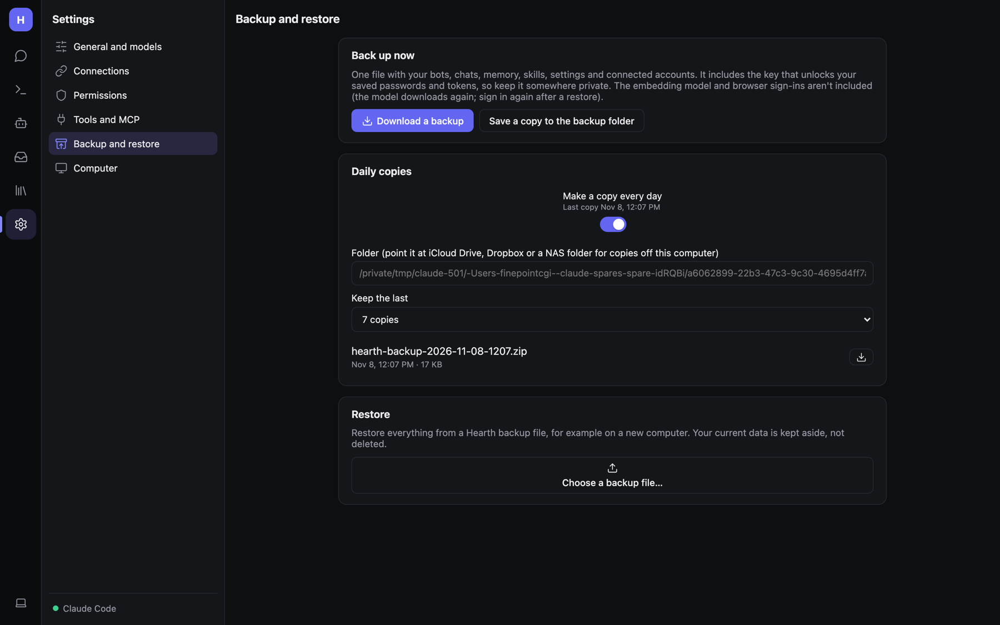

# Backup, restore and moving machines



**Settings → Backup and restore**.

## What's in a backup

One zip file with your bots, chats, memory, skills, settings and connected accounts. It **includes the key that
unlocks your saved secrets** (`vault.key`), so anyone with the file can read your API keys and saved logins. Store
backups somewhere private.

Downloaded models (e.g. the built-in embedding model) are left out; they download again when needed.

## Back up now

- **Download a backup** — the zip downloads to your browser.
- **Save a copy to the backup folder** — writes it to the folder set below.

## Daily copies

1. Tick **Make a copy every day**.
2. **Folder** — point it at iCloud Drive, Dropbox or a NAS folder for copies off this computer. Empty = the default
   `backups` folder inside the data folder.
3. **Keep the last** 3, 7, 14 or 30 copies; older ones are deleted.

The list shows each copy with its date and size. If the last attempt failed, the error is shown here.

## Restore

Restore everything from a Hearth backup file, for example on a new computer:

1. Install Hearth on the new machine and open **Settings → Backup and restore**.
2. Under **Restore**, choose the backup zip.
3. Click **Restart Hearth now** (or, in the desktop app, quit and reopen it).

Your current data is **kept aside, not deleted**, in a `hearth-before-restore-…` folder inside the data folder.
**Cancel restore** backs out before restarting.

## Moving to a new computer: checklist

1. On the old machine: **Download a backup**.
2. On the new machine: install Hearth (service or Docker), restore, restart.
3. Check **Settings → Models**: addresses like `http://localhost:11434` must be right for the new machine.
4. Sign in to the bot browser again if sites ask (browser sign-ins are tied to the machine for some sites).
5. Reconnect Google/Microsoft if they report expired sign-ins.
6. Re-pair chat apps only if they stop answering. Tokens move with the backup.
7. Update Tailscale / phone links if the machine's name changed.

## Manual backups (admins)

With Hearth stopped, copying the whole [data folder](Admin-Installation-and-Hosting.md#the-data-folder) is also a
complete backup. For Docker:

```bash
docker run --rm -v hearth-data:/data -v "$PWD":/out alpine tar czf /out/hearth-data.tgz -C /data .
```
