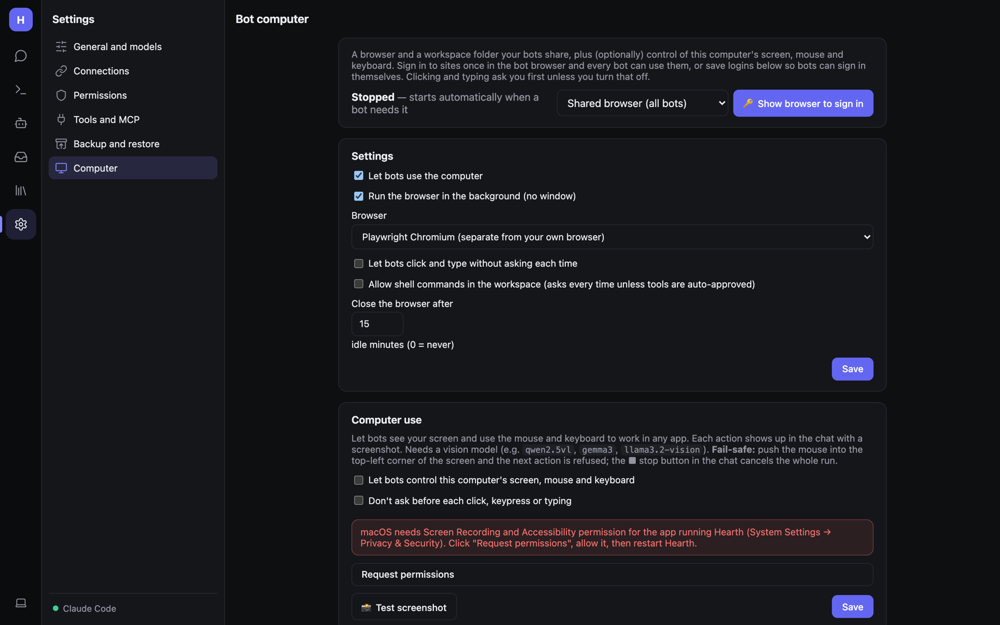

# The bot computer: browser, desktop control, sandboxes, SSH

**Settings → Computer** sets up the machine-level tools bots use: a real browser, a workspace folder, control of this
computer's screen, saved logins and remote computers.

> Available in the desktop app and in the web host with `AllowLocalProcesses` (and in Docker, minus desktop control).
> Not on iOS/Android, where only the workspace file tools work.

## The bot browser

One persistent Chromium profile shared by every bot (one tab each), or a separate profile per bot.

**Status** shows *Running* (● live) or *Stopped — starts automatically when a bot needs it*. Pick **Shared browser
(all bots)** or a bot's own browser, then **🔑 Show browser to sign in**: a window opens on the computer running
Hearth; log in to the sites your bots should use and close it. Sign-ins stick.

The first time, a browser is needed: **⇩ Install browser (Chromium, ~150 MB)**, or choose your installed Chrome or Edge
under **Browser**.

### Settings

| Setting | Meaning |
|---|---|
| **Let bots use the computer** | Master switch for the browser and workspace tools. |
| **Run the browser in the background (no window)** | Headless. Turn off to watch it work. |
| **Browser** | *Playwright Chromium* (separate from your own browser), *Google Chrome* or *Microsoft Edge* (installed). |
| **Let bots click and type without asking each time** | Otherwise `browser_click` and `browser_type` ask first. |
| **Allow shell commands in the workspace** | Enables `run_command` (asks every time unless tools are auto-approved). |
| **Close the browser after N idle minutes** | Default 15; 0 = never. |

### Browser tools

`browser_open`, `browser_snapshot`, `browser_scroll`, `browser_back` and `browser_screenshot` run freely;
`browser_click` and `browser_type` ask first unless allowed. Pages are described to the model as text plus numbered
elements, so it works with non-vision models.

A **live view** at the bottom of the page shows what the bot's browser is showing, refreshed every 1.5 s.

### Per-bot browsers

By default each bot gets its own browser profile with its own cookies and sign-ins (bot editor → Abilities → Browser →
**Its own browser**, with **🔑 Open its browser to sign in** and **Reset its browser**). Switch a bot to **Shared
browser** to use the common one.

## Computer use (desktop control)

Lets bots see this computer's screen and use the mouse and keyboard in any app: `desktop_screenshot`,
`desktop_click`, `desktop_type`, `desktop_key`, `desktop_scroll`, `desktop_drag`, `desktop_open`. Every action returns
a fresh screenshot, so it needs a **vision model** (`qwen2.5vl`, `gemma3`, `llama3.2-vision`, Claude…).

- **Let bots control this computer's screen, mouse and keyboard** — turn it on.
- **Don't ask before each click, keypress or typing** — off by default; each action asks.
- **Fail-safe**: move the mouse to the top-left corner and the next action is refused. ■ in the chat cancels the whole
  run.
- **📸 Test screenshot** checks it works.

Per platform:

- **macOS**: grant **Screen Recording** and **Accessibility** to the app running Hearth (System Settings → Privacy &
  Security). **Request permissions** prompts for them; restart Hearth afterwards.
- **Windows**: works out of the box.
- **Linux**: X11, `xdotool`, and a screenshot tool (`scrot`, `gnome-screenshot` or ImageMagick).

## Sandboxed computer (one per bot)

In a bot's editor, turn on **Computer use** and pick **Its own sandbox**. The bot gets a private Linux desktop
(Chromium, a terminal) in a Docker container instead of your screen. It uses the same `desktop_*` tools but can't see
your screen or files, so its actions don't ask first (typing a saved login still does).

- Needs Docker Desktop. The image (`hearth-desktop:2`) builds automatically the first time (a few minutes).
- The bot editor shows a **live view** (noVNC on 127.0.0.1 behind a random password). You can click and type in it,
  for example to sign in to a site for the bot.
- Its home folder (and sign-ins) persist in a Docker volume.
- It stops after the Computer page's idle time and starts again on demand. **Reset** (or deleting the bot) removes the
  container and its files.

## Saved logins

**＋ Add login**: name, site, username, password → **Save login**. Bots sign in with `browser_fill_login` (bot
browser) or `desktop_type_login` (any app) **without the password reaching the model or the chat**.

Passwords are encrypted with AES-GCM using `vault.key` (owner-only). That keeps them out of chats and logs, but
doesn't protect them from someone who can read your user account's files.

**Protect password and payment fields** — bots can only use saved logins, not type passwords themselves.

## Workspace files

The workspace folder (inside the data folder) is where bots read and write files with `list_files`, `read_file` and
`write_file`, sandboxed to that folder. Browser downloads land in `workspace/downloads`. The page lists what's there;
[Library → Files](Documents-and-Files.md#files) has previews and downloads.

## Remote computers (SSH)

**Remote computers**: add `user@host` (or an `~/.ssh/config` alias) with a note on what it is. Bots with the **Code**
ability get `run_remote` and can run commands there.

- Hearth uses your **SSH keys only**; it never prompts for a password. Set up key login first
  (`ssh-copy-id user@host`).
- Each command asks first by default (Permissions → **Remote computers**).
- **Test** checks the connection.

The same machines are used by [Other agents](Other-Agents.md#agents-on-other-computers) to run Claude Code, Codex and
friends remotely.
