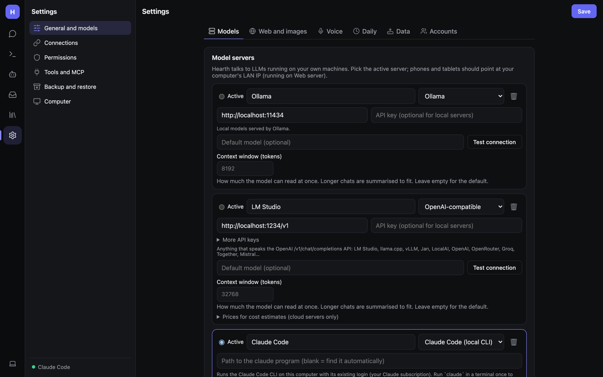

# Model servers

Hearth doesn't include a model; it talks to *model servers*. Set them up in **Settings → General and models →
Models**.

## Adding a server

Use the **＋** buttons below the list: **Ollama**, **LM Studio**, **llama.cpp** (local) or **Claude Code**,
**Claude API**, **OpenAI**, **OpenRouter**, **Groq**, **Other OpenAI-compatible** (cloud and other). Each fills in the
usual address. Then:

1. Adjust the **name** and **address** if needed, and paste an **API key** if the server needs one.
2. Optionally set a **Default model**.
3. **Test connection**.
4. Select **Active** on the server you want to use, and **Save** (top right).

| Provider | Address | Key | Notes |
|---|---|---|---|
| Ollama | `http://localhost:11434` | — | Local. Best for document embeddings. |
| LM Studio / llama.cpp / vLLM / Jan / LocalAI / oMLX | `http://localhost:1234/v1` etc. | optional | OpenAI-compatible |
| **Claude Code** | blank (finds `claude` automatically) or a path | — | Uses your Claude Code login (Claude subscription). Desktop / web host with local access only. |
| **Claude API** | `https://api.anthropic.com` | Anthropic API key | Pay per use |
| OpenAI | `https://api.openai.com/v1` | `sk-…` | |
| OpenRouter | `https://openrouter.ai/api/v1` | OpenRouter key | Hundreds of models |
| Groq | `https://api.groq.com/openai/v1` | Groq key | |
| Any OpenAI-compatible | its base URL | if needed | Together, Mistral, Fireworks, DeepSeek… |

API keys are stored encrypted in `settings.json`.

Cloud providers receive your messages and tool results. Local providers keep everything on your machine. The line
under the chat box always says which: *Runs on your own hardware* or *Sent to a cloud model*.

### Per-server settings

- **Context window (tokens)** — how much the model can read at once. Longer chats are summarised to fit. Leave empty
  for the default.
- **More API keys** — paste extra keys, one per line. Calls take turns across them, and when one hits a rate limit or
  runs out of quota the request moves to the next. Stored encrypted. **Remove extra keys** clears them.
- **Prices for cost estimates (cloud servers only)** — *Input / Output $ per million tokens*, used on the
  [Usage](Admin-Monitoring.md) page. Leave empty for your own hardware (counted as free). Claude API prices are built
  in.

### Notes per provider

- **Claude Code**: run `claude` in a terminal once and sign in (`/login`). Each reply runs `claude -p` in a separate
  empty folder with Claude Code's own tools, MCP servers and settings switched off, so only Hearth's tools are used
  (with the usual approval cards). Models: `opus`, `sonnet`, `haiku` (latest of each) or full model IDs. Images and
  thinking work. Each reply starts the CLI, so it's a little slower than the API.
- **Claude API**: streams through the official Anthropic SDK with adaptive thinking (shown under *Thought process*;
  **Think** raises the effort), native tool calling and images. If a request is declined by a safety classifier, it's
  re-served on a suitable fallback model instead of stopping.
- **OpenAI-compatible cloud APIs**: if a model rejects `max_tokens` or a custom temperature, Hearth retries with
  `max_completion_tokens` / the default temperature automatically.
- **Ollama models without tool support** fall back to plain chat automatically.
- **Embeddings**: Claude can't make them. While a Claude server is active, Documents uses your first local server.

### Phones and other computers

A phone app or another computer must reach the model server over the network:

- Ollama: `OLLAMA_HOST=0.0.0.0 ollama serve`, then use `http://<LAN-IP>:11434`.
- LM Studio: turn on *Serve on local network*.
- From Docker: `http://host.docker.internal:<port>`.

## Backup servers

**Backup servers**: if the active server can't be reached, Hearth retries with these, in order, and says in the reply
which one answered. Each backup uses its own **default model**, so set one. Connecting to a dead server gives up after
10 seconds.

## Automatic model choice

**Choose the model for each message automatically** sends everyday messages to a fast model (local, free, private)
and hard work (research, analysis, writing documents, code, long or multi-part requests, attachments) to a strong one.
It's decided on the spot from each message, with no extra model call; the reason shows in the reply's details. Pick
the server and model for each side. Bots with their own model or server keep theirs.

## Per-bot models

Each bot can run on its own server and model (bot editor → Profile → Model), e.g. a Writer on Claude and everyone
else on local oMLX. If a bot's server is down it falls back to the active server, then your backup servers. Bots on
different servers can still message each other. **Versions** let a coordinator pick between several models for one
bot. See [Bots](Bots.md#profile).

## Generation settings

| Setting | Meaning |
|---|---|
| **Temperature** | Randomness. Lower is more focused. |
| **Max reply tokens** | 0 = unlimited. |
| **Context length (Ollama num_ctx)** | 0 = the model's default. |
| **Continue replies that hit the length limit** | Up to twice, instead of stopping mid-sentence. |
| **Check answers against their sources** | *After research (web pages, documents, email)* or *After any tool use*. The model re-reads its answer against what the tools returned and fixes anything unsupported. One or two extra turns. |
| **Default personality**, **Custom instructions** | Added to every system prompt. |
| **Personality (SOUL.md)** | A voice every bot follows on top of its own role. Saved as `SOUL.md` in the data folder (the same file Hermes and OpenClaw use). |
| **Show thinking from reasoning models** | Show the *Thought process* section. |
| **Auto-name chats with the model** | Automatic chat titles. |
| **Bots take initiative** | Bots act on clear next steps instead of asking first, schedule their own follow-ups, and hand big jobs to background tasks. Anything that changes things still follows Permissions. |

## Recommended models

| Use | Model |
|---|---|
| General chat + tools, local | `qwen3:8b` or larger, `llama3.1`, `mistral-small`, `gpt-oss` |
| Group chats / coordinators | `qwen3:8b`+ (small models get confused) |
| Images (vision) | `gemma3`, `qwen2.5vl`, `llama3.2-vision`, `llava` |
| Computer use | a vision model: `qwen2.5vl`, `gemma3`, `llama3.2-vision`, or Claude |
| Document embeddings | `nomic-embed-text` |
| Hard research, coding | Claude (`sonnet` / `opus`) via Claude Code or the API |
