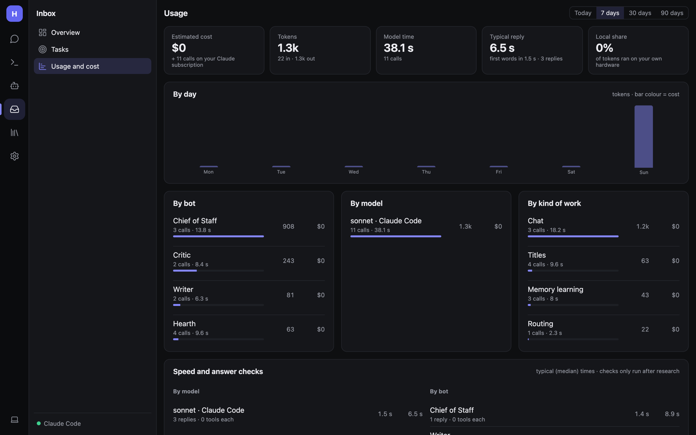

# Monitoring, usage and cost

## Health checks and alerts

- Hearth checks the active model server **every 2 minutes**. When it goes down or comes back, it posts to the
  Inbox activity feed, messages your linked chat apps, and sends a phone notification if set up.
- **Problems** show under **Needs you** on the [Inbox overview](Inbox-and-Tasks.md): no model, a server that can't be
  reached, failed routines and triggers, MCP servers that won't connect.
- `GET /health` reports status (no sign-in needed), for Docker health checks or uptime monitors:

  ```json
  { "status": "ok", "modelServer": "Ollama", "modelServerUp": true, "lastCheck": "…" }
  ```

  Example Docker health check:

  ```yaml
  healthcheck:
    test: ["CMD", "curl", "-fs", "http://localhost:8080/health"]
    interval: 1m
  ```

- **Outgoing webhooks** with the `problem` event send failures to your own systems. See
  [API and webhooks](Admin-API-and-Webhooks.md#outgoing-webhooks).
- The nightly **Self-check** catches a model that got worse or slower. See [Daily](Daily.md#self-check).

## Usage and cost



**Inbox → Usage and cost** counts every model call: chat replies, routines, tasks, heartbeat, memory learning, skill
learning, checks. Choose **Today**, **7**, **30** or **90 days**.

| Tile | Meaning |
|---|---|
| **Estimated cost** | From prices you entered per server (Claude API prices built in). Claude Code calls are counted as *on your Claude subscription*. |
| **Tokens** | Input + output |
| **Model time** | Total time spent waiting on models |
| **Typical reply** | Median reply time |
| **Local share** | Share of tokens that ran on your own hardware |

Below: a chart **By day**, breakdowns by bot, model and kind of work, **Speed and answer checks**, and the **Most
expensive chats and runs**.

To get cost estimates for a cloud server, enter **Input / Output $ per million tokens** under **Settings → Models →
(server) → Prices for cost estimates**. Servers on your own hardware count as $0.

Per reply: click ⏱ under any answer to see each model call and tool with time and tokens.

Usage records are kept in `usage.db` in the data folder.

## Logs

| Install | Where |
|---|---|
| `dotnet run` | The terminal |
| macOS service | `~/Library/Logs/Hearth/hearth.log` |
| Linux service | `journalctl --user -u hearth -f` |
| Windows task | Run `dotnet` with the same arguments in a terminal to see output |
| Docker | `docker logs -f hearth` |

The audit log of every tool call is on **Settings → Permissions → What bots did**.

## Keeping costs down

- Use **Automatic model choice** (Settings → Models) to send everyday messages to a local model.
- Lengthen the **Heartbeat** interval on cloud models.
- Turn on **Offer each reply only the tools it's likely to need** (Tools and MCP).
- Put routine-heavy bots on a local model in their editor.
