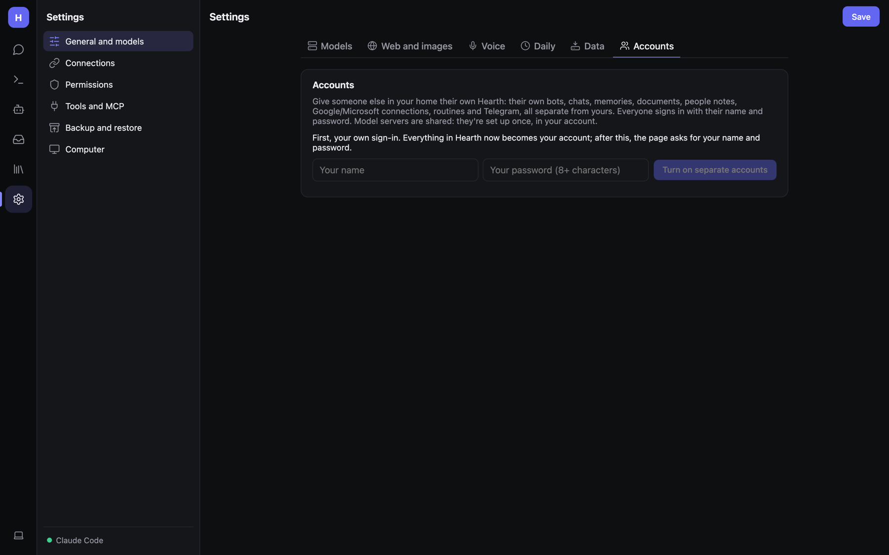
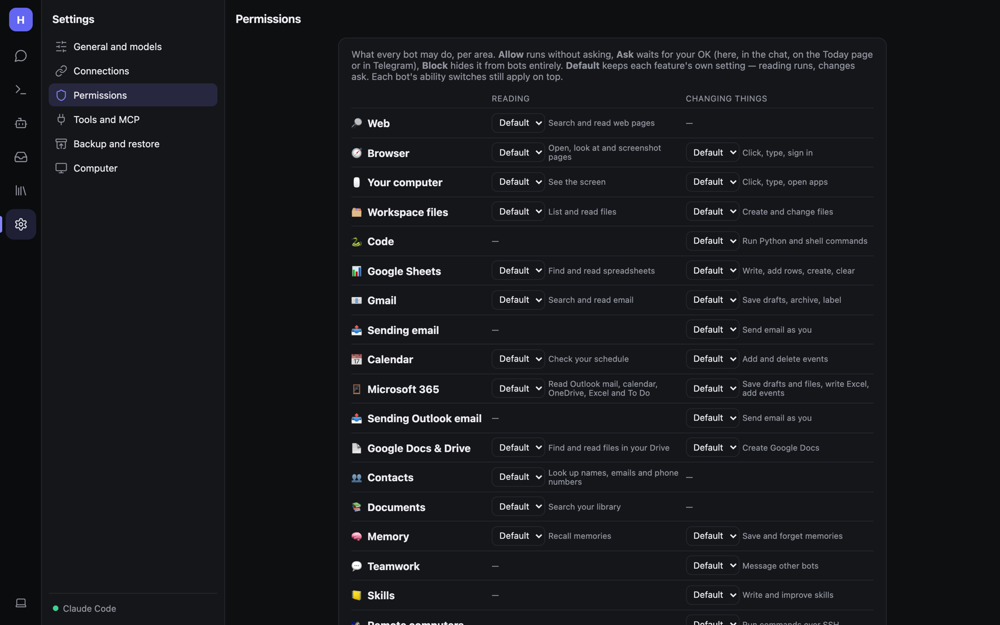

# Security, accounts and permissions

Hearth can send email, change files, run code and drive a browser. This page covers who can sign in, what bots may do
without asking, and how secrets are protected.

## Who can reach Hearth

| Setup | Who can connect |
|---|---|
| Service installed **without** a password | Only this computer (listens on 127.0.0.1) |
| Service installed **with** `HEARTH_PASSWORD` | Any device on your network, after signing in (listens on 0.0.0.0) |
| Docker | Anyone who can reach port 8080; **always set `HEARTH_PASSWORD`** |
| Tailscale (`tailscale serve`) | Only your own devices on your tailnet, over HTTPS |

The **Phone** connections page warns in red if Hearth is reachable from your network without a password.

### Single password

Set `Hearth:Password` (env `Hearth__Password`, or `HEARTH_PASSWORD` for the install scripts and Docker). Everyone signs
in with the same password at `/login`; `/signout` signs out. Two endpoints stay open on purpose:

- `GET /health` — status for uptime monitors (no chat data).
- `POST /hooks/{id}` — webhook triggers, each protected by its own secret.

### Separate accounts (households)

**Settings → General and models → Accounts** gives each person their own Hearth: their own bots, chats, memories,
documents, people notes, Google/Microsoft connections, routines and Telegram, all separate. Everyone signs in with
their name and password.

1. Enter **your name** and a **password** (6+ characters) and click **Turn on separate accounts**. Everything that's in
   Hearth now becomes *your* account.
2. **Add someone** → name and password → **Add account**. They start with the default team of bots and the starter
   skills, and connect their own Google, Microsoft and chat apps. Use a different Telegram bot for each person.
3. Manage accounts here: **Change password**, **Remove**.

**Model servers are shared**: they're set up once, in your account, and everyone uses them.

**Turn off separate accounts** returns to a single Hearth: everyone else loses access until accounts are turned on
again (their data is kept, and they keep their passwords).

## Permissions (what bots may do)

**Settings → Permissions** is one page that decides what every bot may do, per area, separately for **Reading** and
**Changing things**:

| Choice | Meaning |
|---|---|
| **Default** | Each feature's own setting: reading runs, changes ask. Each bot's ability switches still apply on top. |
| **Allow** | Runs without asking. |
| **Ask** | Waits for your OK: in the chat, on the Inbox, or in a chat app. |
| **Block** | The tool is hidden from bots entirely. |

Areas include: Web, Browser, Your computer, Workspace files, Code, Google Sheets, Gmail, Sending email, Calendar,
Microsoft 365, Sending Outlook email, Google Docs & Drive, Contacts, Documents, Memory, Teamwork, Skills, Remote
computers, Bot inbox, and one row per MCP server.

Buttons at the bottom:

- **Careful preset: ask before every change** — sets everything that changes things to Ask.
- **Reset all to Default**.

### Always allowed

When you click **Always allow** on an approval, it's listed here ("*bot* may run *tool* without asking"). **Ask again**
takes it back.

### What bots did (audit log)

Every tool call is logged. Filter by bot (or *Hearth (no bot)*), by text, and by **Today / 7 days / 30 days**.

### Routines and tasks

Routines and tasks run with nobody watching, so anything set to Ask is **skipped** (and they say so). Allow an area
explicitly if a routine must do it.

## Guard against hidden instructions

**On by default.** Web pages, emails, shared files and other bots' replies can contain text written to steer an AI
("prompt injection"). Hearth labels that content as information, not instructions. Once a run has read such content,
anything that changes things (sending, writing, running code or remote commands, saving memories or skills) **asks you
first, with the reason shown**, even where it normally wouldn't.

- Areas you set to **Allow** still run.
- Routines and tasks with no one to ask skip those actions.
- Inbox emails and event-triggered routines start out guarded.

## Secrets

- **Encrypted at rest** with a local key (`vault.key` in the data folder, owner-only permissions): model-server API
  keys, MCP environment values and headers in `settings.json`, chat-app tokens, Google and Microsoft credentials, the
  ntfy token, and saved logins.
- **Saved logins** (Computer page): bots sign in with `browser_fill_login` or `desktop_type_login` without the
  password ever reaching the model or the chat. Encrypted with AES-GCM. This keeps them out of chats and logs, but
  doesn't protect them from someone who can read your user account's files.
- **Backups contain your keys**. Store them somewhere private.
- The bot browser can type into password fields. Turn on **Protect password and payment fields** to block that.

## Other safety rails

- Bots can't loop forever: at most 8 bot replies per message (`MaxBotHops`), two per bot; tasks have a cycle budget;
  code sessions max 60 tool rounds per reply.
- File tools are sandboxed to the workspace or project folder (symbolic links can't escape).
- Model output: raw HTML and non-web links are not rendered; `html`/`svg` previews run sandboxed.
- Skill imports are scanned for risky content and wait for review.
- Computer use has a fail-safe: move the mouse to the top-left corner and the next action is refused.
- Phone calls only from numbers you list.
- Chat apps only answer paired chats.

## Checklist for a new install

1. Set a password, or use Tailscale, before exposing Hearth beyond this computer.
2. Review **Permissions**; consider the **Careful** preset at first.
3. Leave **Guard against hidden instructions** on.
4. Turn off bot abilities you don't need.
5. Set up a [daily backup](Admin-Backup-and-Restore.md) and keep it private.
6. Turn on [phone notifications](Phone-and-Notifications.md#phone-notifications-ntfy) so approvals reach you.
