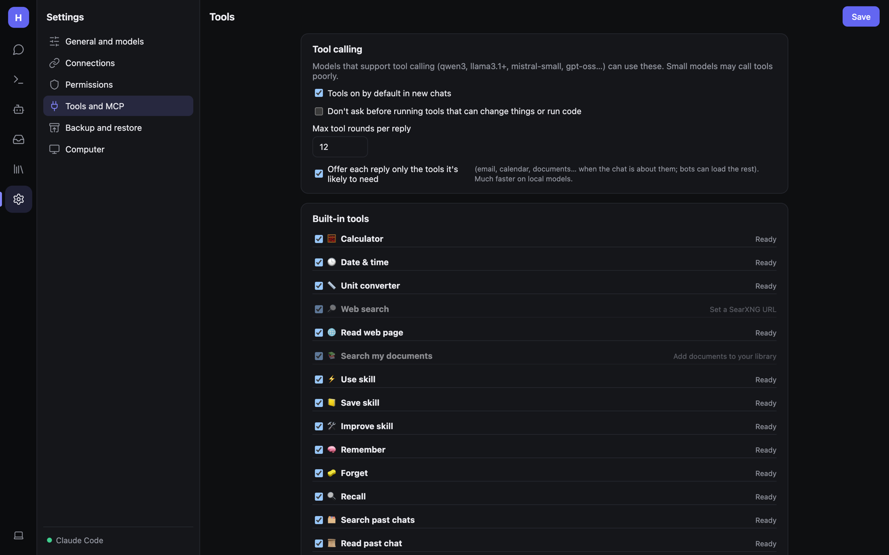

# Tools and MCP servers

**Settings → Tools and MCP** controls tool calling, the built-in tools, the code sandbox, helper agents and MCP
integrations.



## Tool calling

| Setting | Meaning |
|---|---|
| **Tools on by default in new chats** | Otherwise users switch on **Tools** per chat. |
| **Don't ask before running tools that can change things or run code** | Skips approvals globally. Prefer fine-grained choices on [Permissions](Admin-Security-and-Permissions.md). |
| **Max tool rounds per reply** | How many tool-call rounds a normal reply may take (default 12). Code sessions use `Tools.CodeMaxRounds` (60). |
| **Offer each reply only the tools it's likely to need** | Sends a smaller tool list (email, calendar, documents… only when the chat is about them; bots can load the rest). Much faster on local models. |

Tool calling needs a model that supports it: `qwen3`, `llama3.1`/`3.2`, `mistral-small`, `gpt-oss`, Claude… The
model picker shows 🛠 for these.

## Built-in tools

Each built-in tool can be switched off. The right-hand column shows whether it's **Ready**, **asks first**, runs in
the **sandbox**, or what it still needs (e.g. *Set a SearXNG URL*, *Add documents to your library*).

| Tool | Does | Needs |
|---|---|---|
| Calculator (`calculate`) | Exact maths (safe parser, no code) | — |
| Date & time | Date/time in any time zone | — |
| Unit converter | Length, mass, volume, temperature, speed, data… | — |
| Web search | Search with numbered citations | SearXNG URL |
| Read web page (`fetch_url`) | Read a page or PDF as text | — |
| Search my documents | Semantic search over the library | Documents + embedding model |
| Use / Save / Improve skill | Skills | — |
| Remember / Forget / Recall | Long-term memory | Memory on |
| Search past chats / Read past chat | Earlier conversations | — |
| Generate image | Local Stable Diffusion | A1111/Forge or ComfyUI |
| Python (`run_python`) | Runs Python (asks first) | **Allow the Python tool**; desktop or local access |
| Browser, desktop, files, Google, Microsoft… | See their pages | The matching ability |

`fetch_url` and HTTP MCP servers make requests from wherever Hearth runs (the server, for the web host).

### Web search (SearXNG)

Web search and DeepSearch use your own [SearXNG](https://docs.searxng.org) instance, so searches don't go to a
third-party API:

```bash
docker run -d -p 8080:8080 searxng/searxng
```

Enable JSON output in its `settings.yml`:

```yaml
search:
  formats: [html, json]
```

Then enter `http://localhost:8080` under **Settings → General and models → Web and images → DeepSearch**, and choose
how many **Results** to use. (If Hearth itself runs in Docker on port 8080, publish SearXNG on another port.)

## Code sandbox

- **Run code in the sandbox** — Python and shell commands from bots and code sessions run in a Docker container rather
  than directly on this computer. Without Docker, code runs on this computer and asks first.
- **Internet access in the sandbox** — needed to install packages.
- **Image** — the container image used. The card shows *Docker is ready* when it can be used.

## Helper agents

Bots can split a job into parts and hand them to temporary helpers that work at the same time. **Helpers at once**
sets the limit (0 = off). Each helper is a parallel model call, so local servers may slow down with many.

## MCP servers

[Model Context Protocol](https://modelcontextprotocol.io) servers add tools from other apps. Bots need the **MCP
tools** ability to use them, and each server gets its own row on the Permissions page.

### Add an integration (one click)

Popular MCP servers, set up for you: GitHub, Notion, Home Assistant, Workbench, Meridian, Keel PLM, files, Brave Search, library docs, Git
and time. Versions are pinned. Click one, fill in the token or folder it asks for, and **Add**. Secrets are encrypted.

**Workbench** asks for your Workbench address and an API key. Create the key in Workbench under **Admin › Integrations ›
API keys** with the **AI assistants (MCP)** scope plus read access to the areas its tools need (projects, time, sheets,
setup, accounting). The tools only read, and see what the key's roles may see. With a local model, the data stays on
your network.

**Meridian** asks for your Meridian team server's address and a personal access token (avatar menu › **API tokens**).
Its tools read models only, and the token sees the projects and packages you can see.

**Keel PLM** asks for the Keel address and the sign-in client your Keel administrator registered for AI assistants (often
`keel-mcp`). There is no key to paste: when Hearth connects, Keel's sign-in page opens in your browser and Hearth acts as you,
seeing only what you may see. Keel holds export-controlled data, so use it only with Hearth inside your enclave and a local
model. The sign-in lasts until Hearth restarts. This needs the desktop app (the sign-in page has to open on the same computer).

### Servers that sign you in

Some HTTP servers (Keel PLM, and others that follow MCP authorization) don't take a key: they send Hearth to their own sign-in
page. Fill in **Sign-in client id** on the server's row with the OAuth client id the server's administrator gave you. Hearth
opens the sign-in page when it connects, catches the reply on `127.0.0.1`, and keeps the token in memory only.

Header values (keys, tokens) are hidden on the server row. Type a new value to replace one; leaving the hidden text as it is
keeps the stored value.

### Add a server by hand

1. **Add a server by hand**.
2. Choose **Local command (stdio)** (a command and arguments, e.g. `npx -y @modelcontextprotocol/server-filesystem
   /Users/me/Documents`) or **HTTP** (a URL and headers).
3. Optionally tick **Run this server's tools without asking**.
4. **Save & connect**. Its tools are listed when it connects; errors show on the Inbox.

### Import JSON

**Import JSON…** accepts the Claude Desktop / Cursor `mcpServers` format:

```json
{ "mcpServers": {
  "files":  { "command": "npx", "args": ["-y", "@modelcontextprotocol/server-filesystem", "/Users/me/Documents"] },
  "remote": { "url": "https://example.com/mcp", "headers": { "Authorization": "Bearer …" } }
} }
```

### Where MCP servers run

- Local (stdio) servers run on desktop hosts, and on the web host only with `AllowLocalProcesses`.
- iOS and Android can only use HTTP MCP servers (the page says *This platform can only use HTTP MCP servers*).


### Engineering team (Workbench, Meridian and Keel)

With any of the **Workbench**, **Meridian** or **Keel PLM** integrations added, **Bots › Add engineering team** adds one bot per app,
plus the Chief of Staff to route questions that span them:

| Bot | App | Tools |
| --- | --- | --- |
| Program Manager | Workbench | `workbench_*`, memory, calculator |
| Systems Architect | Meridian | `meridian_*`, memory |
| Configuration Engineer | Keel PLM | `keel_*` only (no memory: Keel data is export-controlled) |

Each bot is limited to its own app's tools (`Selected` tools with a `server_*` prefix, so tools the server adds later are included).
Ask the Chief of Staff a question like "what does ECN-000042 affect, and what will it cost?" and it hands the pieces to the right bot.

**How the apps point at each other.** The bots follow a thread from one app to the next through shared ids:

- A Meridian element's tagged values `keel.part` (a Keel part number), `keel.spec` (a Keel specification number) and
  `workbench.project` (a Workbench project code). Find them with `search_elements`, e.g. `kind:Block where tag:keel.part = P-000123`.
- A Workbench project's custom field **Keel program** (set it up in Workbench › Admin › Custom fields) holds the Keel program code;
  `list_custom_field_matches` finds the project for a program.

Keel results start with a `MARKINGS:` line. The Configuration Engineer keeps the most restrictive banner at the top of its answers.