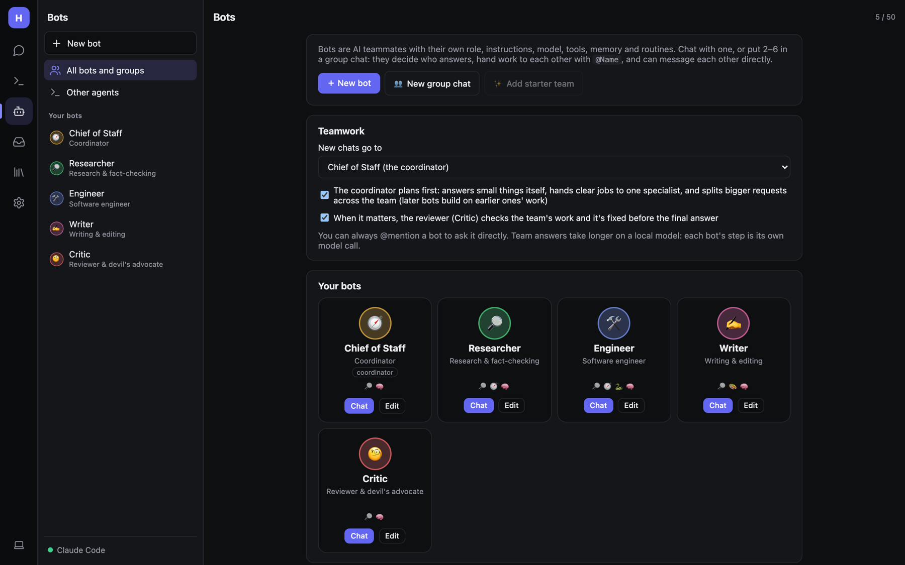
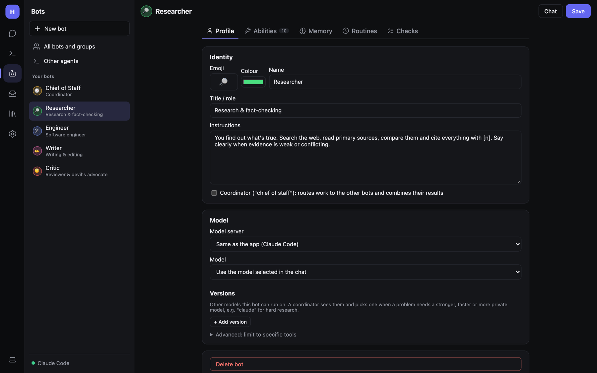
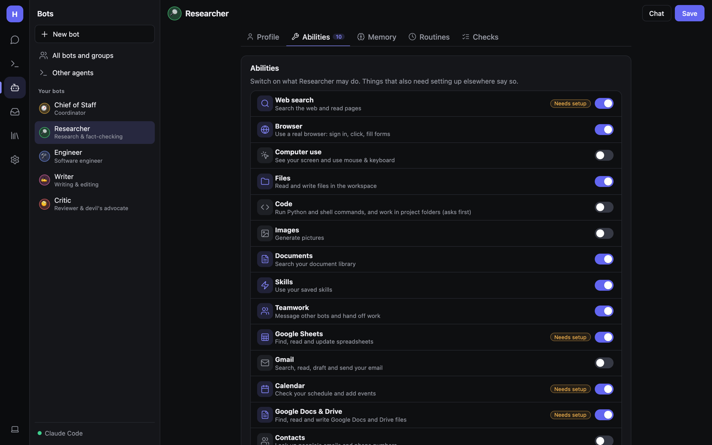
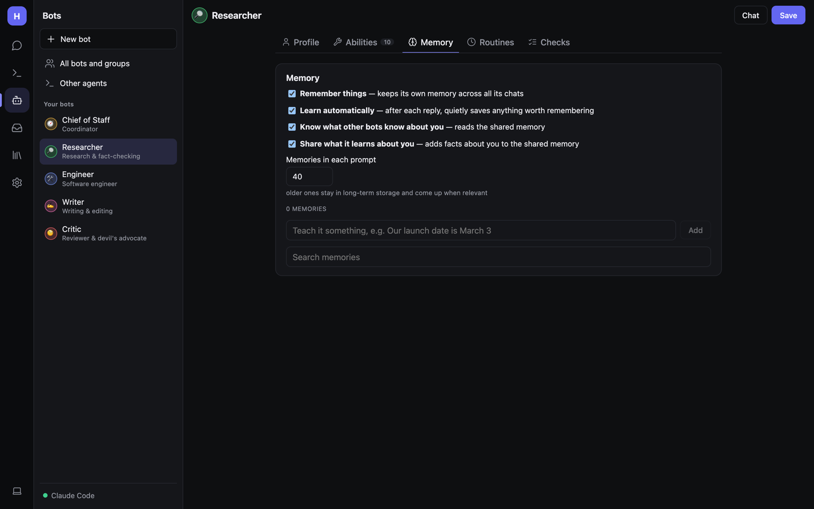
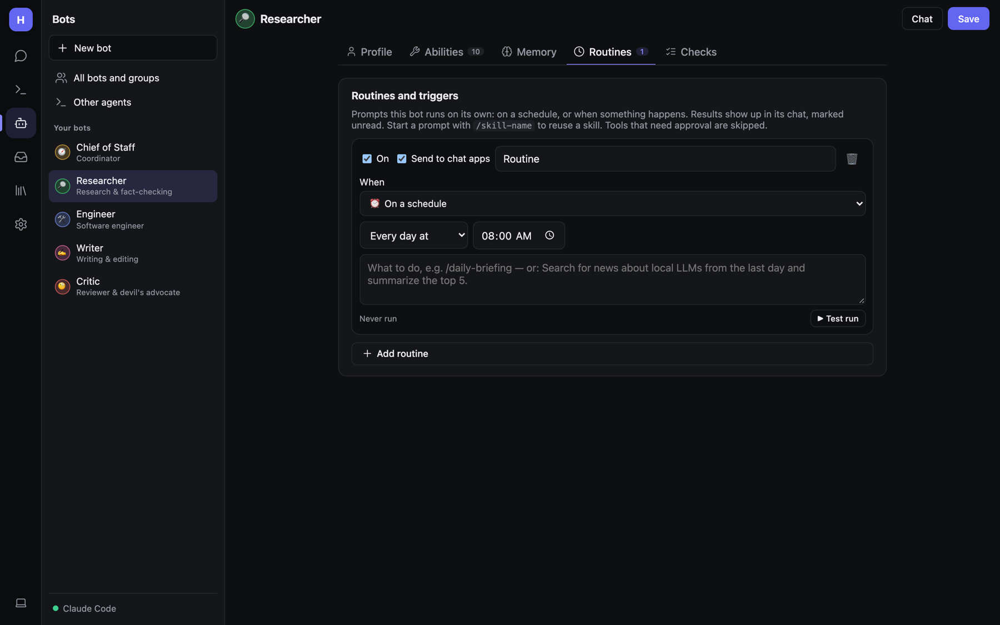
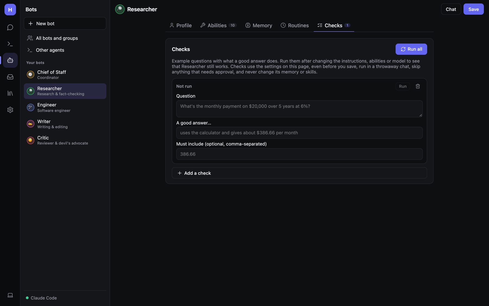

# Bots and teams

A **bot** is an AI teammate. Each one has a name and avatar, a role, its own instructions, an optional model of its
own, a set of abilities (tools), its own memory, routines it runs by itself, and checks that test it. You can have
up to 50.

Open **Bots** in the rail. From here you can:

- **+ New bot** — make one from scratch.
- **New group chat** — start a chat with several bots at once.
- **Add starter team** — Chief of Staff, Researcher, Engineer, Writer and Critic, already set up to work together.
- **Chat** or **Edit** any bot from its card. The small icons on a card show its main abilities.

## Teamwork settings

The **Teamwork** box at the top of the Bots page decides how a team handles requests:

- **New chats go to** — who answers a new chat by default, usually the coordinator (*Chief of Staff*), or plain Hearth.
- **The coordinator plans first** — it answers small things itself, hands clear jobs to one specialist, and splits
  bigger requests across the team (later bots build on earlier ones' work).
- **When it matters, the reviewer (Critic) checks the team's work** and it's fixed before the final answer.

You can always `@mention` a bot to ask it directly. On a local model, team answers take longer, since each bot's step
is its own model call.

## Editing a bot

Click **Edit** on a bot card or its name in the side panel. The editor has five tabs. Remember to click **Save**
(top right) when you're done; **Chat** opens a chat with it.

### Profile

- **Identity** — **Emoji** (or an uploaded picture), **Colour**, **Name**.
- **Title / role** — a short description shown under the name (e.g. *Research & fact-checking*).
- **Instructions** — what this bot does, how it works, its tone, what it should never do. This is the most important
  field.
- **Coordinator ("chief of staff")** — routes work to the other bots and combines their results.
- **Model** — **Model server** and **Model** for this bot. *Same as the app* uses whatever's active. You can put
  one bot on Claude and the rest on a local model; if a bot's server is down it falls back to the active server, then
  your backup servers.
- **Versions** — other models this bot can run on. A coordinator sees them and picks one when a problem needs a
  stronger, faster or more private model. **+ Add version**, then say *when to use it*.
- **Advanced: limit to specific tools** — narrow the bot down to an exact list of tools.
- **Delete bot** (bottom).

### Abilities

Simple on/off switches for what this bot may do. A **Needs setup** label means the ability also needs something set up
elsewhere; it links there.

| Ability | Lets the bot… | Needs |
|---|---|---|
| Web search | Search the web and read pages | A SearXNG address ([Settings → Web](Admin-Tools-and-MCP.md#web-search-searxng)) |
| Browser | Use a real browser: sign in, click, fill forms | Desktop or web host with local access |
| Computer use | See a screen and use mouse & keyboard | A vision model; see below |
| Files | Read and write files in the workspace folder | — |
| Code | Run Python and shell commands, work in project folders (asks first) | Desktop or web host with local access |
| Images | Generate pictures | An image server ([Voice and images](Voice-and-Images.md)) |
| Documents | Search your document library | [Documents](Documents-and-Files.md) |
| Skills | Use your saved skills | — |
| Teamwork | Message other bots and hand off work | — |
| Google Sheets / Gmail / Calendar / Google Docs & Drive / Contacts | Work with your Google account | [Google](Google-Microsoft-and-Email.md) |
| Microsoft 365 | Outlook mail and calendar, OneDrive, Word, Excel, To Do | [Microsoft](Google-Microsoft-and-Email.md#microsoft-365) |
| MCP tools | Tools from your MCP servers | [Tools and MCP](Admin-Tools-and-MCP.md) |

Below the switches are extra settings for some abilities:

- **Browser**: **Its own browser** (separate cookies and sign-ins for this bot) or **Shared browser**. **🔑 Open its
  browser to sign in** opens a window on the computer running Hearth; sign in to the sites the bot should use and close
  it. Sign-ins are kept. **Reset its browser** wipes them.
- **Computer use**: **Its own sandbox** (a private Linux desktop in Docker; can't see your screen or files, so it
  works without asking) or **This computer** (your real screen; asks before each action). See
  [The bot computer](Admin-Bot-Computer.md).
- **Coding**: a **Project folder** and **File edits in that folder** (ask / allow / read only). The bot then has
  coding tools there in its normal chats and when another bot hands it work.

Whatever you allow here is still subject to the global [Permissions](Admin-Security-and-Permissions.md) page.

### Memory

- **Remember things** — keeps its own memory across all its chats.
- **Learn automatically** — after each reply, quietly saves anything worth remembering ("🧠 Remembered: …").
- **Know what other bots know about you** — reads the shared memory.
- **Share what it learns about you** — adds facts about you to the shared memory.
- **Memories in each prompt** — how many are always included (default 40). Older ones stay in long-term storage and
  come up when relevant (`recall_memory`).
- Add a memory by hand (*"Teach it something, e.g. Our launch date is March 3"*), search, edit ✎, or delete 🗑 them.
  **Forget everything** clears this bot's memory.

### Routines

Prompts this bot runs on its own: on a schedule, or when something happens. See
[Routines and triggers](Routines-and-Triggers.md).

### Checks

Checks are example questions with a description of a good answer. Run them after you change a bot's instructions,
abilities or model, to see that it still works.

1. Click **+ Add a check**.
2. **Question** — e.g. *What's the monthly payment on $20,000 over 5 years at 6%?*
3. **A good answer…** — e.g. *uses the calculator and gives about $386.66 per month*.
4. **Must include** (optional) — words the answer must contain, comma-separated: `386.66`.
5. Click **Run** on one check, or **Run all**.

Each check runs in a throwaway chat with the settings on the page (even before you save), skips anything that needs
approval, and never changes the bot's memory or skills. A model judges the answer. Failing checks show as a count on
the tab.

## How bots work together

**In a group chat**, you write normally and Hearth picks who answers (a quick routing call to the model), or you
address someone with `@Name` / `@everyone`. A bot hands work on by mentioning a teammate, who replies next.

**Limits**, so bots can't loop forever: at most 8 bot replies per message (setting `MaxBotHops`) and two per bot.

**Bot-to-bot messages**: with the Teamwork ability, a bot can `message_bot` any teammate. The message and reply appear
in the recipient's own chat (marked unread) and come back to the sender as a tool result. A coordinator can message
several bots in one turn; they work at the same time.

**Handing work to other agents**: bots can also pass coding jobs to Claude Code, Codex and friends. See
[Other agents](Other-Agents.md).

## Tips for good bots

- Give each bot one clear job. "Researcher: finds facts and always cites sources" beats "helpful assistant".
- Say what it should *not* do in the instructions, e.g. "never send email without showing me the draft".
- Turn off abilities a bot doesn't need. Fewer tools means faster, more reliable answers on local models.
- Add two or three **Checks** for anything you rely on, and **Run all** after changing models.
