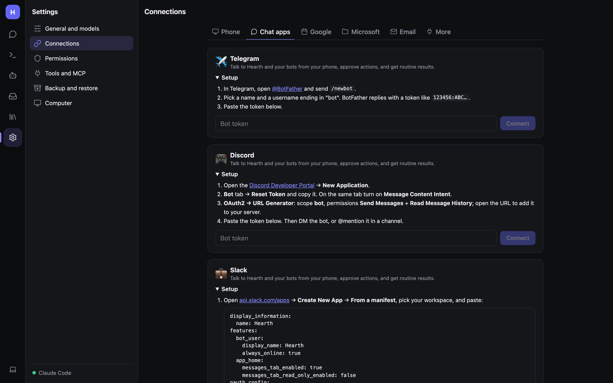

# Chat apps: Telegram, Discord, Slack, Signal, iMessage

Talk to Hearth and your bots from the chat apps you already use, approve actions from anywhere, and get routine
results pushed to you. Set them up in **Settings → Connections → Chat apps**.



None of these need a public address or port forwarding: Telegram uses long polling, Discord its gateway, and Slack
Socket Mode.

## Pairing (all apps)

After connecting an app, click **Get pairing code** and send that code to your bot from your own account. Only paired
chats, and only the person who paired, can talk to Hearth. Everyone else is ignored.

## Telegram

1. In Telegram, open **@BotFather** and send `/newbot`.
2. Pick a name and a username ending in `bot`. BotFather replies with a token like `123456:ABC…`.
3. Paste the token into **Bot token** and click **Connect**.
4. **Get pairing code** and send it to your new bot.

## Discord

1. Open the [Discord Developer Portal](https://discord.com/developers/applications) → **New Application**.
2. **Bot** tab → **Reset Token** and copy it. On the same tab turn on **Message Content Intent**.
3. **OAuth2 → URL Generator**: scope **bot**, permissions **Send Messages** and **Read Message History**. Open the URL
   to add the bot to your server.
4. Paste the token and **Connect**. Then DM the bot, or @mention it in a channel, and pair.

## Slack

1. Open [api.slack.com/apps](https://api.slack.com/apps) → **Create New App → From a manifest**, pick your workspace,
   and paste the manifest shown on the page.
2. **Install to Workspace**. Then **OAuth & Permissions** → copy the **Bot User OAuth Token** (`xoxb-…`).
3. **Basic Information → App-Level Tokens**: create one with scope `connections:write` (`xapp-…`).
4. Paste both tokens and **Connect**. Pair, then DM the app or @mention it in a channel.

## Signal

1. Start the Signal bridge:
   ```bash
   docker compose --profile signal up -d
   ```
   (or run `bbernhard/signal-cli-rest-api` yourself).
2. Link a Signal account to it: open `http://localhost:8081/v1/qrcodelink?device_name=hearth` (port 8080 if you
   started the bridge yourself) and scan the QR code in Signal → Settings → Linked devices. Use a separate number for
   the bot if you can; messages you send from your own number to yourself don't count.
3. Enter the bridge address (`http://signal:8080` from inside Docker, `http://localhost:8081` outside) and that
   account's number.

## iMessage (Mac only)

Shown only when Hearth runs on a Mac.

1. Sign the Mac's **Messages** app in to a separate Apple ID for the bot, so you can text it from your phone.
2. **System Settings → Privacy & Security → Full Disk Access**: add the app running Hearth (for the background service,
   that's `dotnet`), so it can read new messages.
3. Click **Turn on**. The first reply asks permission to control Messages; allow it.
4. Pair from your phone.

## What you can do from a chat app

- Just message it, or send a **photo** (vision models see it), a **file** (PDF/text/code is read; big ones go to
  Documents) or a **voice note** (transcribed; see [Voice](Voice-and-Images.md#voice-memos-and-recordings)).
- Every reply has **🔄 Again · ✂️ Shorter · ➕ More** buttons (Telegram, Discord, Slack).
- Tool approvals arrive as **Allow / Deny** buttons, including approvals from chats on your computer, so you can OK
  things when you're away. Signal and iMessage have no buttons, so choices arrive as *"Reply 1 Allow · 2 Deny"*;
  answer with the number or the word.
- Routine results are pushed to linked chats (when the routine has **Send to chat apps** ticked).
- What else a chat gets is up to you, per chat, under **Connections → Chat apps**: approval requests and routine
  results are on for a new chat; progress of tasks started elsewhere, heartbeat check-ins and model-server alerts are
  off until you turn them on. Tasks you start from the chat always report back to it. **Quiet hours** hold everything
  but approval requests and task questions (and failures). Task updates that arrive then are sent together as one
  "While it was quiet" message when quiet hours end.

### Commands

| Command | Does |
|---|---|
| `/bots` | List your bots |
| `/bot Name` | Switch who answers |
| `/groups`, `/group Name` | Talk to a group of bots (each reply is labelled) |
| `@Name …` | Ask one bot, once |
| `/new` | Start a new conversation |
| `/stop` | Stop the current reply |
| `/notify` | Show what this chat gets |
| `/notify on` / `/notify off` / `/notify approvals` | Everything, nothing, or only approval requests |
| `/quiet 22:00-07:00` / `/quiet off` | Quiet hours: only approvals and task questions come through; task updates arrive together when it ends |
| `/task <goal>` | Start a [task](Inbox-and-Tasks.md#tasks) |
| `/answer …` | Answer a task's question |
