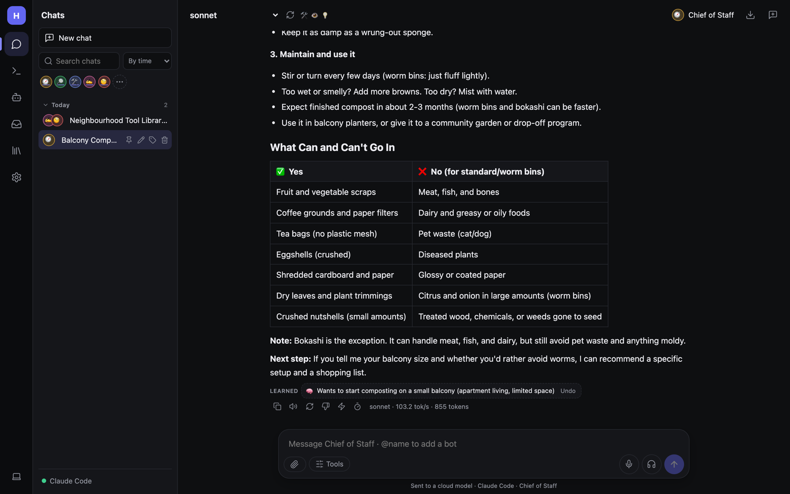
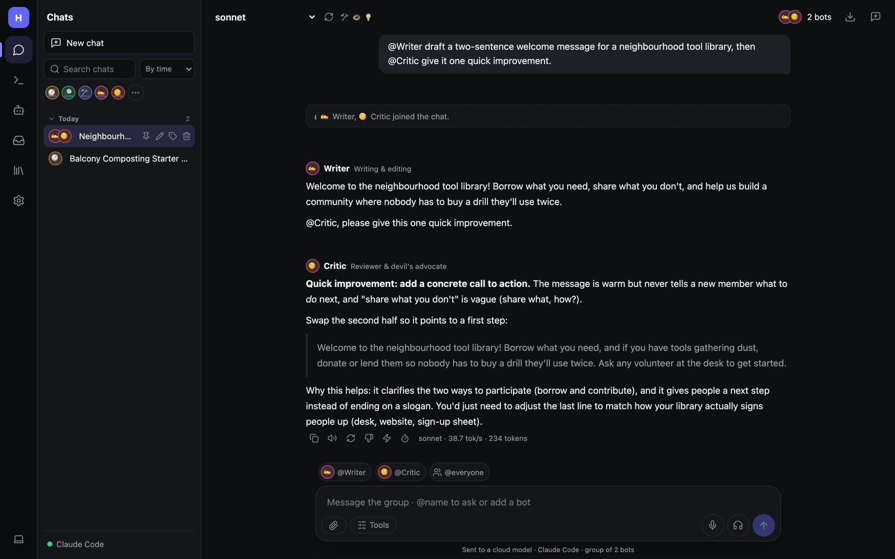

# Chatting



## Sending a message

Type in the box at the bottom and press **Enter**. Replies stream in as they're written. While a reply is running,
the send button turns into **■ Stop**.

Under the box, a line tells you where the message goes: *Sent to a cloud model · Claude Code · Regular mode*, or
*Runs on your own hardware* for local models.

### Composer buttons

| Button | What it does |
|---|---|
| 📎 **Attach** | Add images (for vision models) or documents: PDF, text, code. Small files are pasted into the message; large ones are added to your [Documents](Documents-and-Files.md) and searched. Images are shrunk on your device before sending. |
| **Tools** (options) | Opens the options menu, below. |
| 🎙 **Dictate** | Speak instead of typing. |
| 🎧 **Talk hands-free** | A live voice conversation. See [Voice and images](Voice-and-Images.md). |
| ↑ **Send** / ■ **Stop** | Send, or stop the reply that's running. |

### The options menu

- **Tools** — *Search, files, memory, skills, MCP…* With tools on, the model can call tools: search the web, read a
  page, do exact maths, remember facts, use skills, message other bots, and anything your bots' abilities allow. Each
  tool call appears as a card you can expand. Anything that changes things or runs code asks you first.
- **Think first** — for reasoning models (`qwen3`, `deepseek-r1`, Claude…). The model thinks before answering; the
  thinking is shown under a collapsible **Thought process**.
- **DeepSearch** — multi-step web research: several searches, reading pages, with numbered sources [1] [2] you can
  click. Needs a SearXNG address in **Settings → Web and images**.
- **Personality** — *Regular*, *Fun* (sarcastic and irreverent), *Concise*, *Coder*, *Tutor*, or your own.

## Under every reply



A row of small buttons appears under each answer, followed by the model name, speed (tokens per second) and size:

| Button | What it does |
|---|---|
| **Copy** | Copy the reply as Markdown. |
| 🔊 **Read aloud** | Speak the reply. |
| ↻ **Regenerate** | Ask again for a different answer. |
| 👎 **That's wrong** | Tell Hearth what was wrong (e.g. *"The report goes to Sarah, not Sam"*). It fixes the cause: a memory, a skill, or its instructions. |
| ⚡ **Save as skill** | Save *how* this was done as a skill so it's done the same way next time. See [Skills](Skills.md). |
| ⏱ **Steps and timing** | How the reply was made: each model call and tool, with time and tokens. |

Some replies also show:

- **🧠 Learned** — what Hearth took away from this reply (a fact about you, a person, a preference). Click to see it;
  **Take this back** removes it.
- **Drew on** — the memories, skills and people that shaped this answer.

Under messages you sent: **Edit** (change it and resend) and **⚡ Save this prompt as a reusable skill**.

## What replies can contain

- Markdown: headings, lists, **tables**, quotes.
- Code blocks with a **Copy** button. `html` and `svg` blocks get a **Preview** (sandboxed); `csv` blocks get a
  **Table** view.
- Images made with `/imagine` or the image tool.
- Source chips when web search or DeepSearch was used.

For safety, raw HTML from a model and non-web links are not rendered.

## Chatting with bots

- **One bot**: click its avatar under the search box (or in **Bots**). The chat header shows its name.
- **Several bots**: type `@Name` to bring a bot in, or `@everyone`. In a group, Hearth picks who should answer each
  message, or the people you mention answer. Bots can hand off to each other by mentioning a teammate.
- The bar above the box shows quick-mention chips for everyone in the chat.


In this example, Writer drafts a message and hands over to Critic, who suggests an improvement. See
[Bots and teams](Bots.md) for how this works and how to limit it.

## Skills and commands

Type `/` at the start of the box to pick a [skill](Skills.md). Whatever follows the name is its input:

```
/summarize <paste your notes here>
/imagine a lighthouse at dusk, oil painting
```

## Finding and organising chats

- **Search chats** (top of the side panel) searches titles and content.
- The selector next to it groups chats **By time**, **By person** (the bot you talked to) or **By topic**. Topics are
  set automatically after the first reply; change one with the 🏷 button on a chat.
- Hover a chat for **pin**, **rename**, **topic** and **delete**. Chats get a title automatically.
- Click a group header to fold it.

Chats are saved on the computer running Hearth (see [Backup](Admin-Backup-and-Restore.md)).
