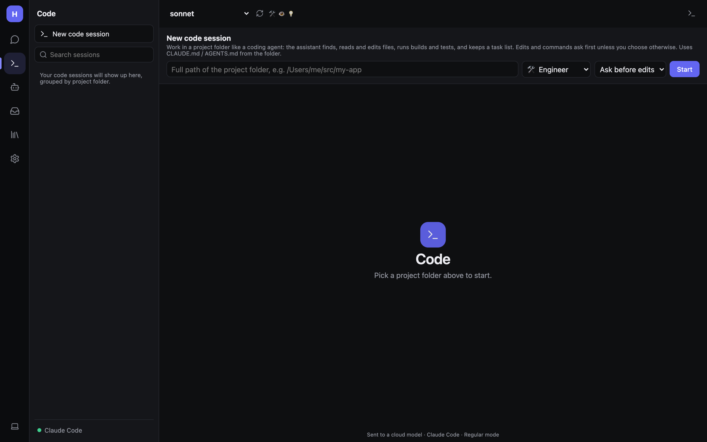

# Code sessions

Code sessions turn a bot into a coding agent for one project folder, in the style of Claude Code. It finds files,
searches, reads, edits (with diffs you can undo), runs builds, tests and git, and keeps a live task list.

> Code sessions need the desktop app, or the web host with local access turned on
> (`Hearth:AllowLocalProcesses`). They don't run on phones. See
> [Installation and hosting](Admin-Installation-and-Hosting.md#local-access).

## Before you start

Coding is a bot ability. Turn on **Code** for the bot you want (Bots → bot → Abilities). The starter **Engineer** has
it already.

## Starting a session

1. Click **Code** (`>_`) in the rail, then **New code session**.
2. Enter the **full path of the project folder**, e.g. `/Users/me/src/my-app`.
3. Pick **who works on it**: a bot (it brings its own model, memory and instructions) or plain Hearth.
4. Pick a **permission mode** (below) and click **Start**.

Each session is its own conversation, so you can run several side by side. They're listed in the Code tab, grouped by
project folder, apart from your normal chats.

## What the agent can do

| Tool | Does |
|---|---|
| `glob` | Find files by pattern |
| `grep` | Search file contents |
| `read` | Read a file with line numbers |
| `edit` / `write` | Change or create files. Each change is shown as a diff. |
| `undo_edit` | Take an edit back |
| `bash` | Run builds, tests, git… (in the code sandbox when it's on) |
| `todo_write` | Keep a live task list, shown above the message box |

The agent reads the folder's `CLAUDE.md` or `AGENTS.md` and knows the git branch. Paths can't leave the folder
(symbolic links included). A session gets up to 60 tool rounds per reply (setting `Tools.CodeMaxRounds`).

## Permission modes

Switch any time from the bar under the chat header.

| Mode | Behaviour |
|---|---|
| **Ask before edits** | Every edit and every command asks first. Safest. |
| **Accept edits** | File edits apply straight away; commands still ask (unless they run in the sandbox). |
| **Plan only** | Read-only. The agent investigates and proposes a plan; **Go ahead** switches mode and starts. |

## Project folders on normal bots

A coding bot can also have a **project folder** (Bots → bot → Abilities → Coding). It then has the same coding tools
there in its normal chats, and when another bot hands it work with `message_bot`, using the edit setting you chose
(ask / allow / read only). Edits that need your OK are refused when you aren't watching (for example in a routine).

## The code sandbox

With **Settings → Tools and MCP → Code sandbox → Run code in the sandbox** on, Python and shell commands run in a
Docker container instead of directly on your computer. Commands in the sandbox don't need to ask in *Accept edits*
mode. **Internet access in the sandbox** lets it install packages. See [Tools and MCP](Admin-Tools-and-MCP.md#code-sandbox).

## Hand it to a different agent

If you'd rather have Claude Code, Codex or Gemini CLI do the work, see [Other agents](Other-Agents.md).
