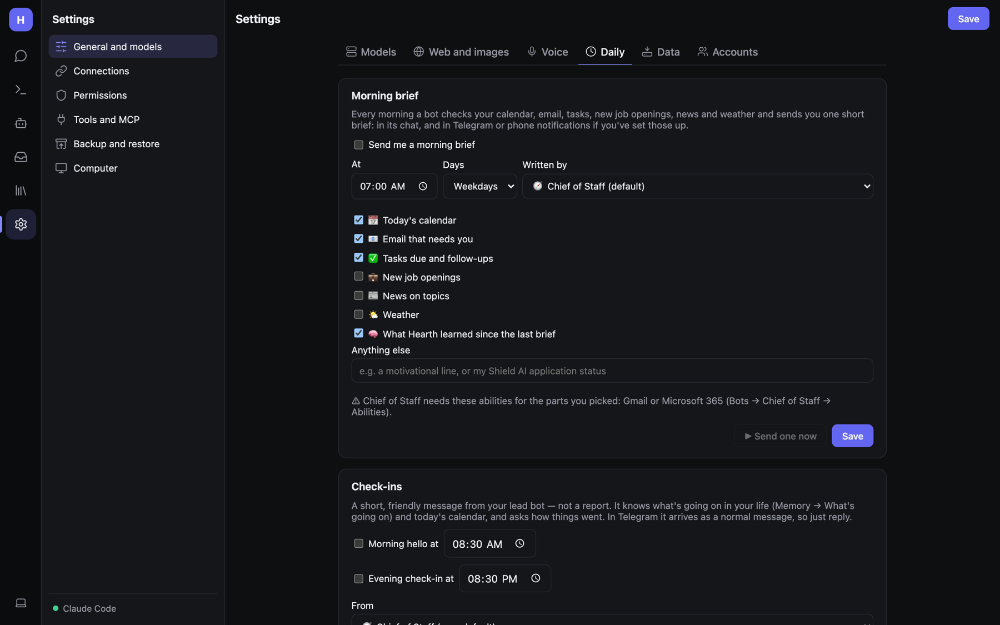

# Daily: morning brief, check-ins and self-check

Ready-made routines you switch on in **Settings → General and models → Daily**. For the proactive **Heartbeat**, see
[Inbox](Inbox-and-Tasks.md#heartbeat).

## Morning brief

Every morning a bot checks your calendar, email, tasks, job openings, news and weather, and sends you one short brief:
in its chat, and in Telegram (or other chat apps) and phone notifications if you've set those up.

1. Tick **Send me a morning brief**.
2. Pick the time (**At**), **Days** (*Weekdays* or *Every day*), and which bot writes it (**Written by**, the
   coordinator by default).
3. Tick the parts you want:
   - 📅 Today's calendar
   - 📧 Email that needs you
   - ✅ Tasks due and follow-ups
   - 💼 New job openings
   - 📰 News on topics
   - 🌤️ Weather
   - 🧠 What Hearth learned since the last brief
4. **Anything else** — free text, e.g. *a motivational line*, or *my visa application status*.
5. **Save**. **▶ Send one now** to try it.

If the chosen bot is missing an ability a part needs (e.g. Gmail or Microsoft 365 for email), a warning tells you
which, and where to turn it on.

## Check-ins

A short, friendly message from your lead bot, not a report. It knows what's going on in your life (Memory → What's
going on) and today's calendar, and asks how things went. In Telegram it arrives as a normal message, so just reply.

- **Morning hello at** and/or **Evening check-in at**, with times.
- **From** — which bot sends it.
- The test button runs whichever fits the time of day now (morning before 3 pm).

## Self-check

Each night Hearth asks the default model quick questions: maths and date tools, a unit conversion, a follow-up, a
plain answer, and its own features (people notes, plans, undo, skills, contacts when connected). If more fail than
last time, or replies get much slower, it reports a problem in the activity feed and sends a phone notification if
those are set up. Anything a check creates is removed afterwards.

- **Run the self-check every night**.
- **Thorough** — also checks web research with the answer check and a team hand-off (takes several minutes).

The results table shows each run's time, model, passed count, average speed and any failures. Useful after updating
a model or changing servers.
