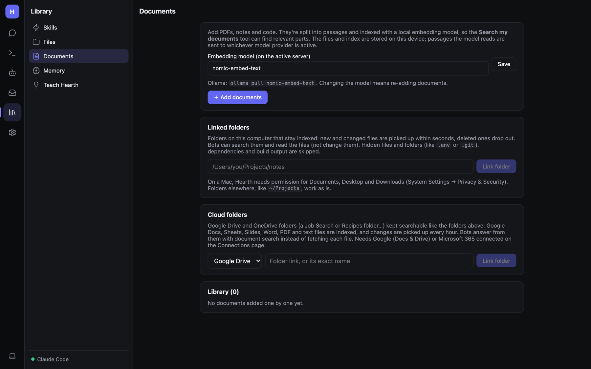
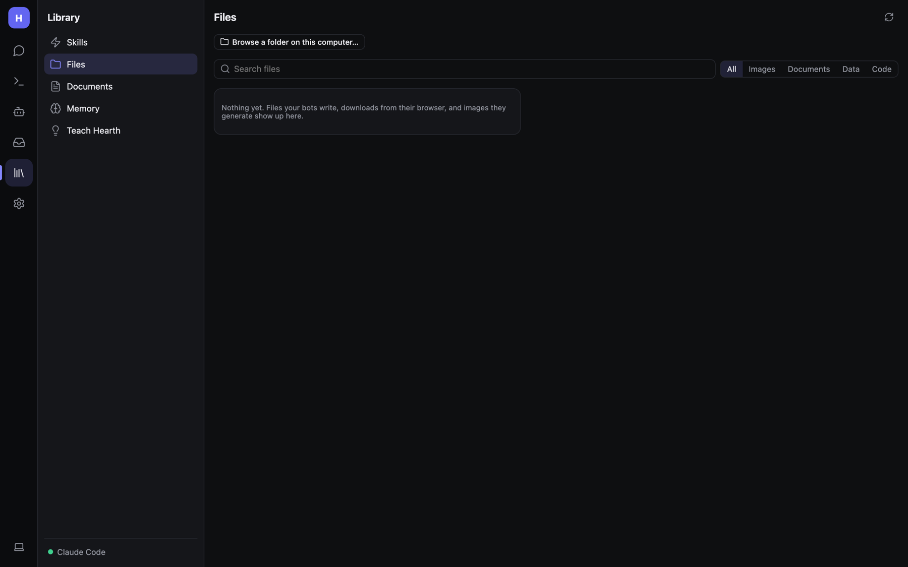

# Documents and files

## Documents (your library)

Add PDFs, notes and code so bots can search them. Documents are split into passages and indexed with an embedding
model; the **Search my documents** tool finds the relevant parts. Files and the index stay on the computer running
Hearth; only the passages a model reads are sent to it.

### Set up the embedding model

1. On your model server, get an embedding model. With Ollama: `ollama pull nomic-embed-text`.
2. In **Embedding model (on the active server)** enter its name and click **Save**.

Changing the model means re-adding documents. If no embedding model answers, documents are still searched by keyword.
Claude can't make embeddings: while a Claude server is active, Hearth uses your first local server for them.

### Adding documents

- **+ Add documents** — upload files one at a time. They show under **Library**.
- Attach a big file in a chat — it's added here automatically.
- **Linked folders** — a folder on this computer that stays indexed: new and changed files are picked up within
  seconds, deleted ones drop out. Enter the path (e.g. `/Users/you/Projects/notes`) and **Link folder**. Hidden files
  (`.env`, `.git`), dependencies and build output are skipped. **Sync now** re-indexes.
- **Cloud folders** — a Google Drive or OneDrive folder kept searchable the same way. Changes are picked up about
  every hour. Needs Google (Docs & Drive) or Microsoft 365 connected under
  [Connections](Google-Microsoft-and-Email.md).

On a Mac, Hearth needs permission for Documents, Desktop and Downloads (System Settings → Privacy & Security) to link
folders there.

**Recent changes by bots** lists files bots changed in linked folders.

To let a bot search documents, turn on its **Documents** ability.

## Files

**Library → Files** collects everything bots made: files in the workspace folder and images from chats. Filter them,
preview them, **Download**, **Delete**, or **Open chat** to see where a file came from.

The **workspace folder** is a sandbox bots can read and write with the **Files** ability (`list_files`, `read_file`,
`write_file`). Browser downloads land in `workspace/downloads`. It's inside Hearth's data folder.
