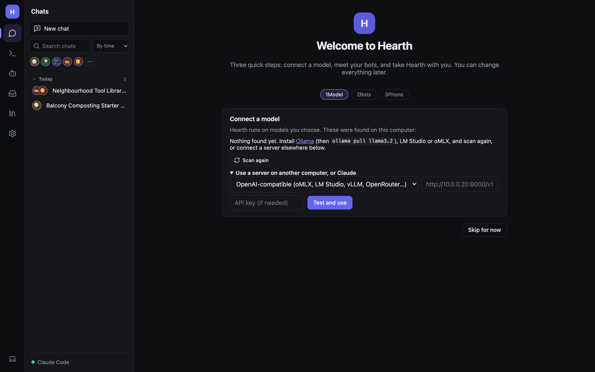
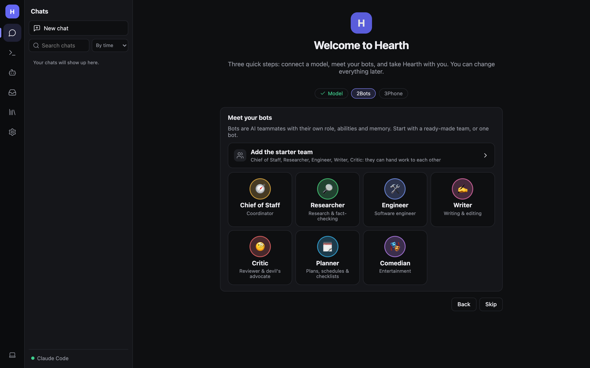
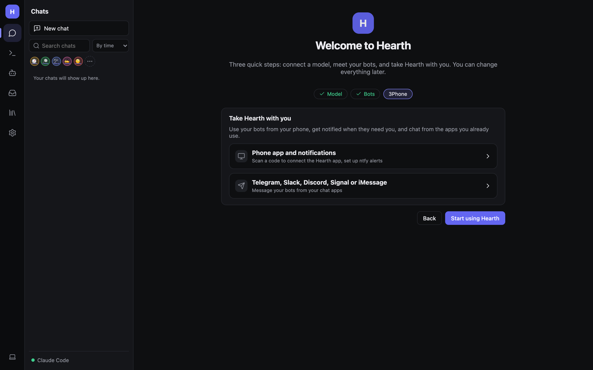
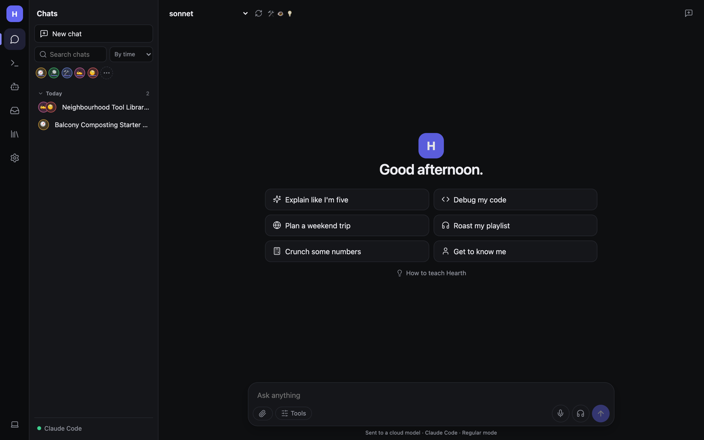

# Getting started

This page takes you from nothing to your first answer in about ten minutes.

## 1. Pick how you'll run Hearth

| Option | Best for | How |
|---|---|---|
| **Web app** | Trying it out; any OS | `dotnet run --project src/Hearth.Web`, then open http://localhost:5291 |
| **Desktop window** | Linux, Windows or macOS without a browser tab | `dotnet run --project src/Hearth.Desktop` |
| **Background service** | Always on, starts at login | `scripts/install-service-macos.sh` (or the Linux / Windows script) |
| **Docker** | A home server or NAS | `HEARTH_PASSWORD=pick-one docker compose up -d`, then http://&lt;server&gt;:8080 |
| **Phone/tablet app** | Native iOS / Android (MAUI) | See [Installation and hosting](Admin-Installation-and-Hosting.md#native-apps-maui) |

You need the [.NET 10 SDK](https://dotnet.microsoft.com/download) for the first three. The full details, ports and
options are in [Installation and hosting](Admin-Installation-and-Hosting.md).

> **Tip:** Most people run the **background service** on the computer that has the models, then use Hearth from
> their phone as an installed web app. See [Phone and notifications](Phone-and-Notifications.md).

## 2. Have a model ready

Hearth doesn't include a model; it connects to one. Any of these works:

- **Ollama** (easiest local option). Install from [ollama.com](https://ollama.com), then:
  ```bash
  ollama pull qwen3:8b          # thinking + tool calling (recommended)
  ollama pull nomic-embed-text  # for searching your documents
  ```
- **LM Studio**, **oMLX**, **llama.cpp**, **vLLM**, **Jan**, **LocalAI**: start their OpenAI-compatible server.
- **Claude Code**: if you have a Claude subscription, run `claude` once in a terminal and sign in. Hearth reuses that
  login.
- **A cloud API**: Claude API, OpenAI, OpenRouter, Groq… you'll need an API key.

For tool use (web search, files, bots messaging each other), pick a model that supports tool calling, such as
`qwen3`, `llama3.1`/`3.2`, `mistral-small` or `gpt-oss`, or a Claude model. Very small models get confused in group
chats; `qwen3:8b` or larger works much better.

## 3. The welcome wizard

The first time you open Hearth, the **Welcome** page walks you through three steps.

### Step 1: Model



Hearth scans this computer for Ollama, LM Studio and oMLX and lists what it finds. Click one to use it.

If nothing is found, or your model runs on another computer:

1. Open **Use a server on another computer, or Claude**.
2. Choose the kind of server: *OpenAI-compatible*, *Ollama*, or *Claude Code (your Claude subscription)*.
3. Enter its address, for example `http://10.0.0.20:8000/v1`, and an API key if it needs one.
4. Click **Test and use**. Hearth checks it can reach the server and moves on.

The dot at the bottom of the sidebar turns green and shows the server's name once it's connected.

### Step 2: Bots



Bots are AI teammates with their own role, abilities and memory.

- **Add the starter team** adds five bots that already know how to work together: **Chief of Staff** (a coordinator
  that hands work to the others), **Researcher**, **Engineer**, **Writer** and **Critic**.
- Or click a single bot to add only that one (Planner and Comedian are also available here).
- **Skip** if you'd rather just chat with plain Hearth for now. You can add bots any time from **Bots**.

### Step 3: Phone



Links to set up the phone app, notifications and chat apps. These are all optional; click **Start using Hearth** to
finish. You can come back to them later from **Settings → Connections**.

## 4. Ask your first question



Type into **Ask anything** at the bottom and press **Enter** (Shift+Enter for a new line). Or click one of the
suggestions to see what Hearth can do.

The line under the box tells you where your message goes, for example *Sent to a cloud model · Claude Code · Regular
mode*, so you always know whether your words leave your computer.

Next: [Tour of the interface](Tour-of-the-Interface.md) or straight to [Chatting](Chatting.md).
