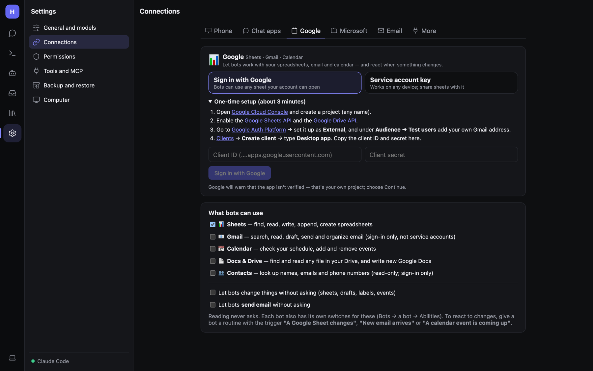
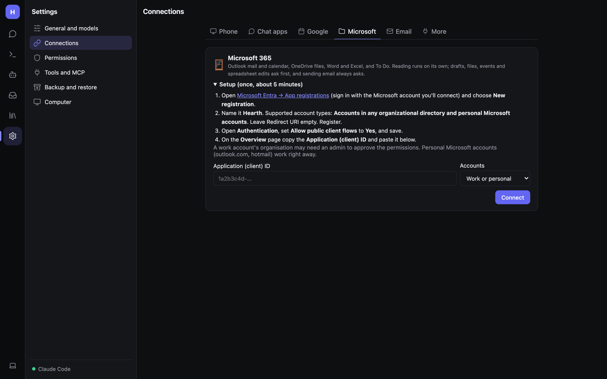
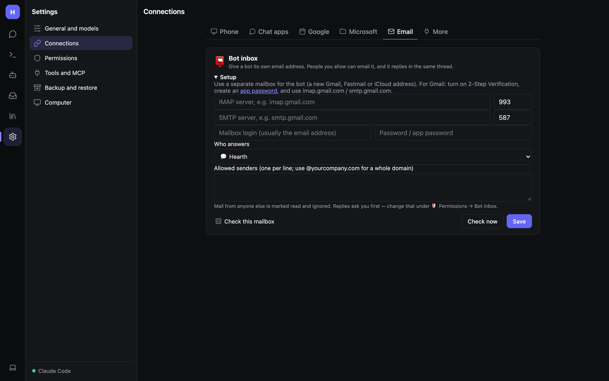

# Google, Microsoft 365 and the bot inbox

Connect your accounts so bots can work with your spreadsheets, email, calendar and files, and react when something
changes. All in **Settings → Connections**.

Tokens and keys are encrypted on disk with Hearth's local key. Each connection only does something for bots that have
the matching ability switched on (Bots → bot → Abilities).

## Google: Sheets, Gmail, Calendar, Docs & Drive, Contacts

There are two ways to connect.

### Option A: Sign in with Google (recommended on a computer)

Bots can then use anything your account can open. This uses a free OAuth client in your *own* Google Cloud project
(about 3 minutes, once):

1. Open the [Google Cloud Console](https://console.cloud.google.com) and create a project (any name).
2. Enable the **Google Sheets API** and the **Google Drive API** (plus Gmail, Calendar, People APIs if you'll use them).
3. Go to **Google Auth Platform** → set it up as **External**, and under **Audience → Test users** add your own Gmail
   address.
4. **Clients → Create client** → type **Desktop app**. Copy the client ID and secret into Hearth.
5. Click **Sign in with Google**. Google will warn that the app isn't verified; that's your own project, so choose
   **Continue**.

The sign-in needs a browser on the same computer as Hearth. If the browser doesn't open, use the *Browser didn't
open? Click here* link.

### Option B: Service account key (works on phones)

1. In the same kind of project, enable the Sheets and Drive APIs.
2. **Service accounts → Create** → open it → **Keys → Add key → JSON**.
3. Paste the downloaded file's contents into Hearth and **Connect**.
4. Share each spreadsheet with the service account's email (Share → Editor).

Service accounts can use Sheets and Drive, but **not Gmail or Contacts** (they can't read a personal inbox).

### Choosing what bots can use

Under **What bots can use**, tick the services you want:

| Service | Bots can… | Tools |
|---|---|---|
| **Sheets** | Find, read, write, append, create spreadsheets | `sheets_find`, `sheets_info`, `sheets_read`, `sheets_write`, `sheets_append`, `sheets_create`, `sheets_add_tab`, `sheets_clear` |
| **Gmail** | Search, read, draft, send and organize email | `gmail_search`, `gmail_read`, `gmail_draft`, `gmail_send`, `gmail_organize` |
| **Calendar** | Check your schedule, add and remove events | `calendar_events`, `calendar_create`, `calendar_delete` |
| **Docs & Drive** | Find and read any file in your Drive, write new Google Docs | |
| **Contacts** | Look up names, emails and phone numbers (read-only) | |

After ticking a new service, click **Reconnect to grant access** so Google asks for the extra permission.

Spreadsheets can be referred to by URL, ID or name; values are entered as if typed, so formulas work. Reading never
asks. Changes ask first, unless you tick **Let bots change things without asking (sheets, drafts, labels, events)**.
**Sending email always asks** unless you separately tick **Let bots send email without asking**.

### Triggers

Google adds three routine triggers: **A Google Sheet changes**, **New email arrives** and **A calendar event is coming
up**. See [Routines and triggers](Routines-and-Triggers.md).

## Microsoft 365

Outlook mail and calendar, OneDrive, Word, Excel and To Do. One-time setup, about 5 minutes:

1. Open **Microsoft Entra → App registrations** (sign in with the Microsoft account you'll connect) and choose
   **New registration**.
2. Name it **Hearth**. Supported account types: **Accounts in any organizational directory and personal Microsoft
   accounts**. Leave Redirect URI empty. **Register**.
3. Under **Authentication**, set **Allow public client flows** and save.
4. On the **Overview** page copy the **Application (client) ID** and paste it into Hearth.
5. Sign in when asked.

Then turn it on for each bot under **Bots → (bot) → Abilities → Microsoft 365**. Chats without a bot can always use it.
A work account's organisation may need an admin to approve the permissions; personal accounts (outlook.com, hotmail)
work right away.

The Permissions page has separate rows for **Microsoft 365** and **Sending Outlook email**.

## Bot inbox (email)

Give a bot its own email address. People you allow can email it, and it replies in the same thread.

1. Use a **separate mailbox** for the bot. For Gmail, create an **app password** and use `imap.gmail.com` /
   `smtp.gmail.com`.
2. Enter the IMAP/SMTP details and pick which bot answers.
3. List **allowed senders**: addresses, or whole domains like `@yourcompany.com`.
4. Tick **Check this mailbox**. **Check now** checks straight away.

Mail from anyone else is marked read and ignored. Each email thread is one conversation. Replies wait for your OK (on
the Inbox, Telegram…) unless you set **Bot inbox → change** to **Allow** on the
[Permissions](Admin-Security-and-Permissions.md) page. Inbox emails start out *guarded* against hidden instructions.

## More connections

Anything with an MCP server (GitHub, Notion, Home Assistant, databases…) can be added on
[Tools and MCP](Admin-Tools-and-MCP.md). The **More** tab also holds the [API and outgoing webhooks](Admin-API-and-Webhooks.md).
