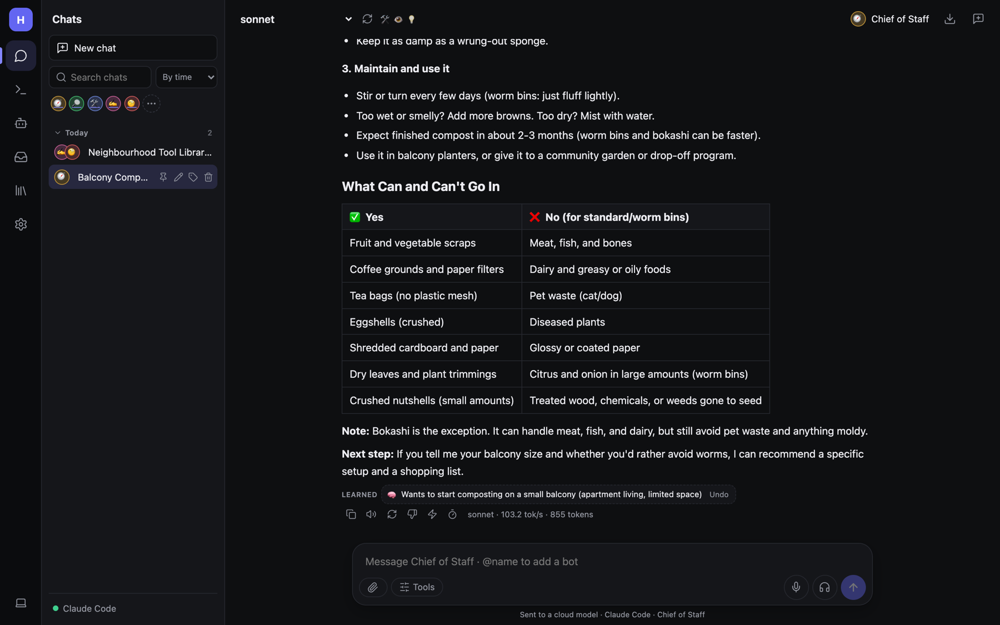

# Hearth Wiki

Hearth is a private AI assistant that runs on **your own models** (Ollama, LM Studio, oMLX, llama.cpp, vLLM…) or on
Claude and any OpenAI-compatible service. You get a chat app, a **team of bots** that can talk to each other, tools,
memory, documents, routines that run on their own, coding sessions, and links to your phone, Telegram, Slack, email,
Google and Microsoft 365.

This wiki has two halves:

- **User guide**: day-to-day use: chatting, bots, routines, skills, memory, and the apps you connect.
- **Admin guide**: installing, hosting, model servers, security, permissions, backups and troubleshooting. Read
  this if you run Hearth for yourself on a server, or for a household.

## Start here

| If you want to… | Read |
|---|---|
| Install Hearth and get your first answer | [Getting started](Getting-Started.md) |
| Learn your way around the screen | [Tour of the interface](Tour-of-the-Interface.md) |
| Get more out of a chat (Think, DeepSearch, tools, voice) | [Chatting](Chatting.md) |
| Build a team of AI helpers | [Bots](Bots.md) |
| Have bots work on their own on a schedule or event | [Routines and triggers](Routines-and-Triggers.md) |
| Put Hearth on your phone | [Phone and notifications](Phone-and-Notifications.md) |
| Run it on a server, always on | [Installation and hosting](Admin-Installation-and-Hosting.md) |
| Decide what bots may do without asking | [Security and permissions](Admin-Security-and-Permissions.md) |

## User guide

1. [Getting started](Getting-Started.md)
2. [Tour of the interface](Tour-of-the-Interface.md)
3. [Chatting](Chatting.md)
4. [Bots and teams](Bots.md)
5. [Routines and triggers](Routines-and-Triggers.md)
6. [Inbox: Overview, heartbeat, tasks and usage](Inbox-and-Tasks.md)
7. [Code sessions](Code-Sessions.md)
8. [Other AI agents (Claude Code, Hermes, Codex…)](Other-Agents.md)
9. [Skills and teaching by showing](Skills.md)
10. [Memory and teaching Hearth](Memory-and-Teaching.md)
11. [Documents and files](Documents-and-Files.md)
12. [Voice and images](Voice-and-Images.md)
13. [Daily routines: morning brief, check-ins, self-check](Daily.md)
14. [Phone and notifications](Phone-and-Notifications.md)
15. [Chat apps: Telegram, Discord, Slack, Signal, iMessage](Chat-Apps.md)
16. [Google, Microsoft 365 and the bot inbox](Google-Microsoft-and-Email.md)

## Admin guide

1. [Installation and hosting](Admin-Installation-and-Hosting.md)
2. [Model servers](Admin-Model-Servers.md)
3. [Security, accounts and permissions](Admin-Security-and-Permissions.md)
4. [Tools and MCP servers](Admin-Tools-and-MCP.md)
5. [The bot computer: browser, desktop control, sandboxes, SSH](Admin-Bot-Computer.md)
6. [API and outgoing webhooks](Admin-API-and-Webhooks.md)
7. [Backup, restore and moving machines](Admin-Backup-and-Restore.md)
8. [Monitoring, usage and cost](Admin-Monitoring.md)
9. [Troubleshooting](Troubleshooting.md)
10. [Updating these screenshots](Maintaining-the-Docs.md)

## Words used in this wiki

| Word | Meaning |
|---|---|
| **Model server** | The program that runs the AI model: Ollama, LM Studio, Claude Code, OpenAI… Hearth talks to it. |
| **Bot** | An AI teammate with its own name, instructions, abilities, memory and routines. |
| **Hearth** (as a chat partner) | Plain chat with no bot picked. |
| **Ability** | An on/off switch on a bot: web search, browser, files, code, Gmail… |
| **Tool** | A single action a model can take, such as `web_search` or `gmail_send`. Abilities group tools. |
| **Routine** | A prompt a bot runs on its own when a trigger fires (a time, a webhook, a new email…). |
| **Skill** | A reusable set of instructions (a `SKILL.md`) any bot can follow, or you can run with `/name`. |
| **Approval** | When a bot wants to do something that changes things, Hearth asks you first: Allow or Deny. |
