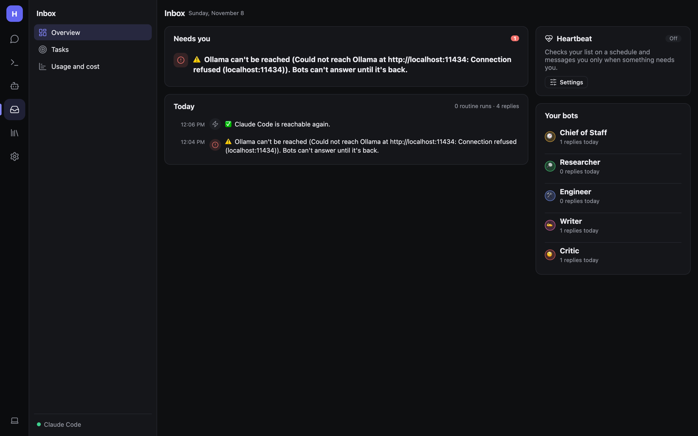
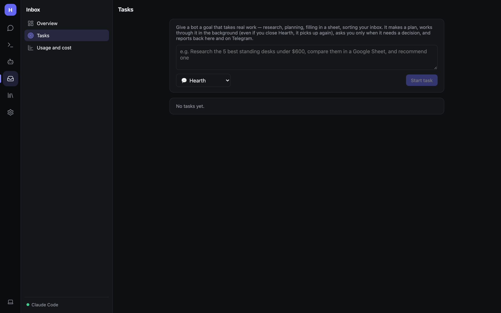
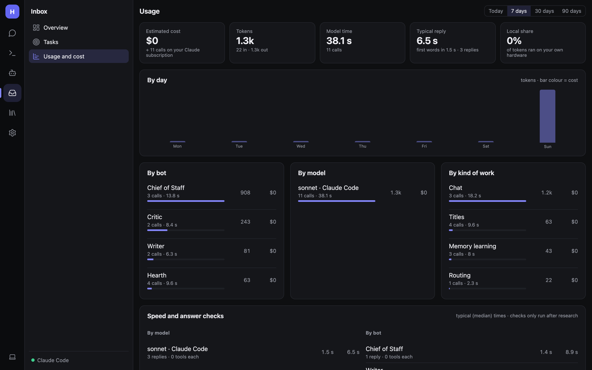

# Inbox: overview, heartbeat, tasks and usage

The **Inbox** (📥 in the rail) is where you see what's going on and what's waiting for you. A red badge on the rail
icon means something needs you.

## Overview

- **Needs you** — approvals waiting for your OK (approve or deny right here), and problems: a model server that can't
  be reached, failed routines and triggers, MCP servers that won't connect. In the screenshot, Hearth points out that
  a configured Ollama server isn't running.
- **Today** — a live activity feed: replies, routine runs, connection changes.
- **Heartbeat** — proactive check-ins (below).
- **Your bots** — how many replies each bot gave today and its next scheduled routine.
- Unread bot chats (results of routines and bot-to-bot messages).

### Approvals

When a bot wants to do something that changes things (send an email, edit a file, run a command, click in a browser),
Hearth asks first. You can answer:

- in the chat where it happened,
- on the Inbox overview: **Allow**, **Deny** or **Always allow**,
- in Telegram, Discord, Slack (buttons) or Signal/iMessage (reply *1* or *2*),
- from a phone notification (ntfy).

**Always allow** adds that tool to the **Always allowed** list on the
[Permissions](Admin-Security-and-Permissions.md) page, where you can take it back with **Ask again**.

## Heartbeat

The **Heartbeat** card turns on proactive check-ins. Every 15 minutes to 4 hours, Hearth (or a bot you pick) goes
through a checklist you write, for example:

> Anything due today, important email, finished tasks, things I asked you to watch.

It uses its tools to look, and messages you (here and on your linked chat apps) **only when something needs your
attention**. Quiet check-ins leave no trace. Set **Quiet from … until …** for the night. **Check in now** runs one
straight away.

Each check-in is a model call; on a paid cloud model, pick a longer interval.

## Tasks

Tasks are for long jobs that need many steps, such as *"research the five best e-bikes under $2,000 and write a
comparison"*.

1. **Inbox → Tasks**, write the goal, pick who works on it (a bot or 💬 Hearth), **Start task**.
   Or from a chat app: `/task <goal>`.
2. The bot writes a plan (`task_plan`), then works through it in the background in cycles (`task_step`), and finishes
   with a report (`task_done`).
3. When it needs a decision it asks you (`task_ask`). Answer on the task page, or with `/answer` in a chat app.
4. Milestones are posted to the chat that started the task.

You can **pause**, **resume** or **cancel** a task at any time. Each task has a cycle budget so it can't run forever,
and tasks survive restarts.

**Follow-ups** (on the same page) are times a bot scheduled to come back to a chat on its own, for example *"check
whether the package shipped tomorrow"*. They post only when there's something new. **Open chat** or **Run now**.

## Usage and cost

**Inbox → Usage and cost** shows, for **Today**, **7**, **30** or **90 days** (7 by default):

- **Estimated cost**, **Tokens** (in and out), **Model time**, **Typical reply** time, and **Local share** (how much ran
  on your own hardware).
- **By day** chart (bar colour = cost).
- Breakdown by bot, model and kind of work: chat, routines, tasks, heartbeat, memory learning…
- **Speed and answer checks**, and **Most expensive chats and runs**.

Local models count as $0 unless you enter prices for that server. Claude Code is covered by your subscription and
counted as such. To see one reply's cost and steps, click ⏱ under it.

Admins: see [Monitoring, usage and cost](Admin-Monitoring.md) for prices and alerts.
