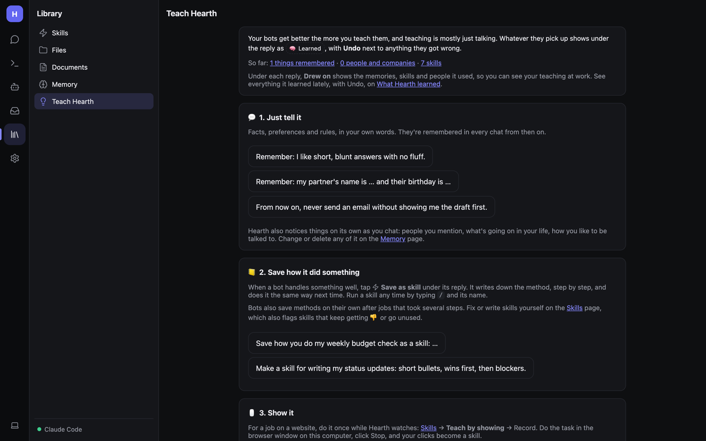
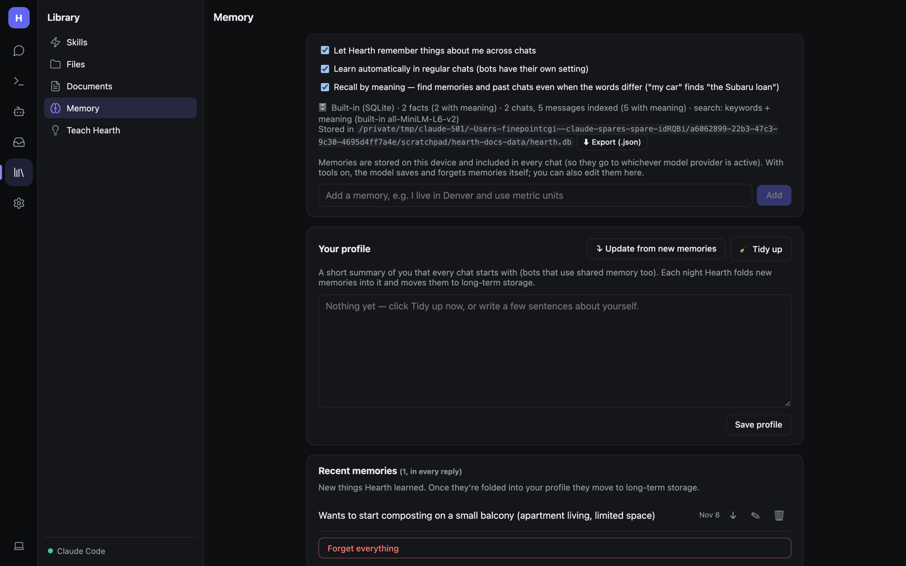
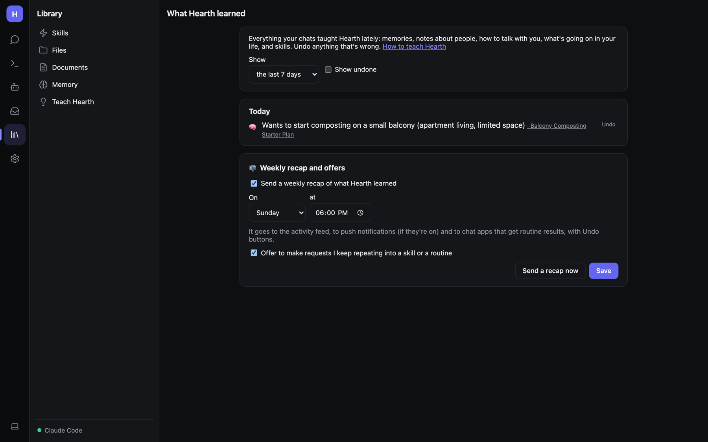

# Memory and teaching Hearth

Hearth remembers things about you across chats, keeps notes on the people and companies you mention, and learns how
you like to be talked to. Everything is stored on the computer running Hearth.

## Teach Hearth

**Library → Teach Hearth** explains the ways to make your bots better. Teaching is mostly just talking:

1. **Just tell it.** Facts, preferences and rules, in your own words:
   - *Remember: I like short, blunt answers with no fluff.*
   - *Remember: my partner's name is … and their birthday is …*
   - *From now on, never send an email without showing me the draft first.*
2. **Save how it did something.** When a bot handles something well, tap ⚡ **Save as skill** under the reply. See
   [Skills](Skills.md).
3. **Show it.** Record a task in a browser with **Teach by showing**.
4. **Correct it.** 👎 **That's wrong** under a reply, then say what was wrong. Hearth fixes the cause: the memory, the
   skill, or the instructions.

Whatever Hearth picks up shows under the reply as 🧠 **Learned**, with **Undo** next to it. **Drew on** under a reply
shows which memories, skills and people it used.

### Bring over what ChatGPT or Claude knows

At the bottom of Teach Hearth, **Bring over what ChatGPT or Claude knows** imports what another assistant has learned
about you:

- **Quick way**: ask ChatGPT or Claude the question shown on the page, paste its answer, and click **Look at it**.
- **Thorough way**: import an export file.

You pick what's kept.

## The Memory page

### Switches

- **Let Hearth remember things about me across chats**.
- **Learn automatically in regular chats** (bots have their own setting in their editor).
- **Recall by meaning** — finds memories and past chats even when the words differ (*"my car"* finds *"the Subaru
  loan"*).

The status line shows where memory is stored and how much is indexed. **⬇ Export (.json)** saves everything.

You can add a memory by hand: *"I live in Denver and use metric units."*

### Your profile

A short summary of you that every chat starts with (and bots that use shared memory). Write it yourself, or:

- **Update from new memories** — folds recent memories into it. Each night Hearth does this automatically and moves
  them to long-term storage.
- **🧹 Tidy up** — suggests an updated profile, merges duplicate facts and drops outdated ones. Untick anything you want
  to keep as it is, then **Apply**. **↶ Undo last update** if you don't like the result.

### Recent memories and long-term storage

**Recent memories** are new things Hearth learned. Each has ✎ edit, 🗑 delete, and ↓ move to long-term storage.
**Long-term storage** holds older facts; they come up when relevant rather than in every prompt.
**Forget everything** wipes memory (you're asked to confirm).

### People & companies, life threads

- **People & companies** — notes bots keep about people and companies you mention, with how they're related.
- **What's going on in your life** — open threads (a move, a job search, a trip) so bots can ask how it's going.
- **How your bots are with you** — the tone and habits they've learned work for you.

### Past chats

Bots search earlier conversations with `search_past_chats` and `read_past_chat` when you refer to something from
before. A bot only sees chats it was part of.

## What Hearth learned

**Teach Hearth → What Hearth learned** lists everything your chats taught Hearth recently: memories, notes about people,
how to talk with you, what's going on in your life, and skills. Pick **the last 7 / 30 / 90 days**, tick **Show undone**
to see things you removed, and **Undo** anything that's wrong. When two facts conflict, choose **New is right** or
**Old is right**.

**Weekly recap and offers**:

- **Send a weekly recap of what Hearth learned** — on a day and time you pick. It goes to the activity feed, push
  notifications (if on) and chat apps, with Undo buttons. **Send a recap now** to try it.
- **Offer to make requests I keep repeating into a skill or a routine**.

## How memory is stored (for admins)

Everything lives in one SQLite database, `hearth.db` in the data folder: shared facts, each bot's notes (kept apart by
scope), your profile, and a search index of every chat. Meaning-based search uses a small built-in embedding model
(all-MiniLM-L6-v2, about 23 MB, downloaded once, runs on the CPU) on desktop and the web host. On phones, or if it can't
download, Hearth uses your server's embedding model (Settings → Documents) or falls back to keywords.
