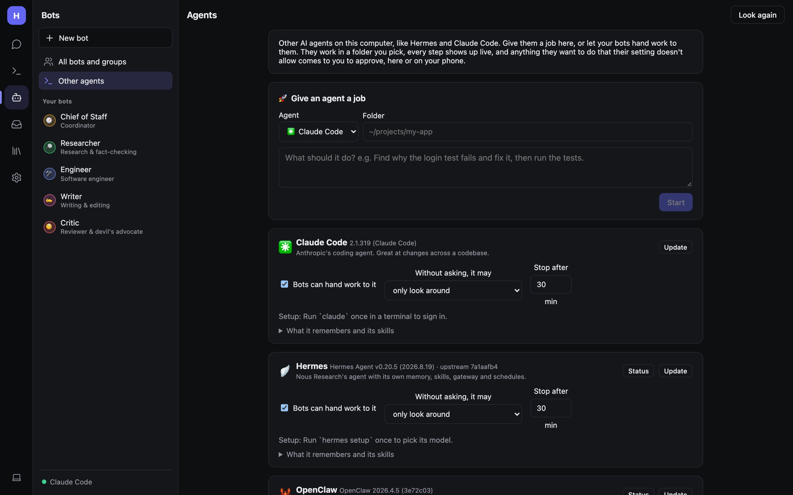

# Other AI agents

Hearth can drive the coding and personal agents already installed on your computer: **Claude Code**, **Hermes**,
**OpenClaw**, **Gemini CLI** and **Codex**. You can give them jobs yourself, or let your bots hand work to them.

Open **Bots → Other agents**. Hearth looks for installed agents and shows a card for each, with its version.
**Look again** rescans.

> Agents run as programs on the computer, so this page works in the desktop app or the web host with local access.

## How Hearth talks to them

| Agent | Runs as |
|---|---|
| Claude Code | `claude -p` headless stream |
| Hermes | `hermes acp` (Agent Client Protocol) |
| OpenClaw | ACP |
| Gemini CLI | `gemini --acp` |
| Codex | via `codex-acp` |

Each card's **Setup** line tells you what to run once if it isn't ready yet, for example *Run `claude` once in a
terminal to sign in* or *Run `hermes setup` once to pick its model*. **How to install** links appear for agents that
aren't installed.

## Giving an agent a job

1. In **Give an agent a job**, pick the **Agent** and a **Folder** (e.g. `~/projects/my-app`).
2. Describe the job, e.g. *Find why the login test fails and fix it, then run the tests.*
3. Click **Start**.

You watch every step live on the job page, and can send follow-ups in the same session. Jobs, whether you started
them or a bot did, are listed under **Recent jobs**.

## Per-agent settings

On each agent's card:

- **Bots can hand work to it** — lets your bots use `hand_off_to_agent`.
- **Without asking, it may** — what it can do on its own:
  - *only look around* (default)
  - *change files in the folder*
  - *do anything (no asking)* — it won't ask before running commands or changing files. Use it only on folders you
    can restore.
  - *nothing but look (refuse the rest)*

  Anything beyond this becomes a normal Hearth approval: in the app, on the Inbox, or in Telegram. Routines can't
  approve, so in a routine those steps are refused.
- **Stop after N min** — a time limit per job.
- **Status** and **Update** — check and update the agent.
- **What it remembers and its skills** — view and edit the agent's memory files (a backup is kept), copy what Hearth
  knows about you into them, and share Hearth's skills with it (they're linked into its skills folder and kept
  current).

## Bots handing work to agents

With **Bots can hand work to it** on, a bot can call `hand_off_to_agent` with a job and a folder (the chat's code
folder or a linked folder), then `follow_up_agent` to continue it. A coordinator can split work between your bots and
these agents.

## Agents on other computers

Under **Other computers**, **Add a computer** you can reach over SSH with a key (no password prompts). Hearth finds
the agents installed there and runs them over SSH, with the same live steps, approvals and follow-ups. The settings
above apply on every computer. Bots pick a computer with the `computer` argument of `hand_off_to_agent`.

See [The bot computer](Admin-Bot-Computer.md#remote-computers-ssh) for SSH setup.
