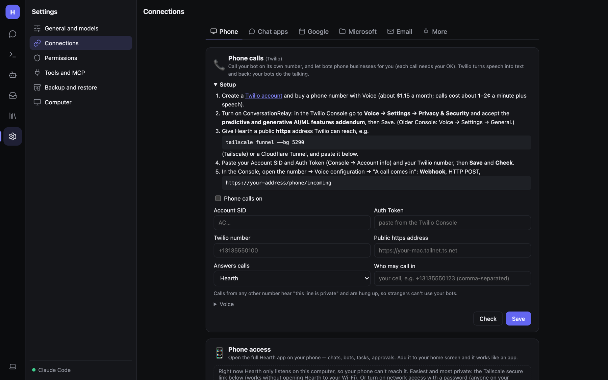

# Phone and notifications

Everything in **Settings → Connections → Phone**.



## Hearth on your phone (phone access)

The full Hearth app (chats, bots, tasks, approvals) works on your phone's browser and installs to the home screen like
an app.

> Phone access needs the web version of Hearth: the [background service or Docker](Admin-Installation-and-Hosting.md).
> The desktop window on its own can't be reached from a phone.

The **Phone access** card shows QR codes for your links:

- **In the Hearth app** — if you have the native Hearth app, scan this with your phone's camera and it opens
  connected.
- **In the browser** — scan, sign in, then **Share → Add to Home Screen** (iPhone) or **⋮ → Install app** (Android).

### Recommended: Tailscale (works anywhere, private, HTTPS)

1. Install [Tailscale](https://tailscale.com) on the computer running Hearth and on your phone, signed in to the same
   account.
2. On the computer, run once (5290 is the service's default port):
   ```bash
   tailscale serve --bg 5290
   ```
3. The card now shows **✓ Serving Hearth at https://…ts.net**. Open that link on your phone and add it to your home
   screen.

Hearth stays closed to your Wi-Fi and the internet; only your own devices on your tailnet can reach it. Setting a
password too is still a good idea.

### Plain home-network access

Install the service with a password, which also makes it listen on your network:

```bash
HEARTH_PASSWORD='pick-a-strong-one' scripts/install-service-macos.sh
```

(Docker: set `HEARTH_PASSWORD` in `docker-compose`.) If Hearth is reachable from your network **without** a password,
this card shows a red warning: anyone on your Wi-Fi could use your bots.

## Phone notifications (ntfy)

Approvals, heartbeat alerts, finished tasks and routines, and problems, pushed to your phone with the free
[ntfy](https://ntfy.sh) app. Works even if Telegram is down.

1. Install ntfy on your phone (iPhone or Android).
2. In the **Phone notifications** card, scan the QR code to subscribe to your private topic (or add the topic in the
   app by hand).
3. Turn on the switch and **Send test**.

Messages are short by default, with no chat content, unless you turn on **Include details**. **New topic** makes a
new private topic if the old one leaked.

ntfy.sh is a free public server. For full privacy run your own:

```bash
docker compose --profile ntfy up -d      # port 8082
```

then enter `http://<this machine>:8082` as the **Server** and subscribe the ntfy app to it. An access token, if your
server needs one, is stored encrypted.

## Phone calls (Twilio)

Call your bot on its own phone number, and let bots phone businesses for you (each outgoing call needs your OK).
Twilio turns speech into text and back; your bots do the talking.

1. Create a [Twilio](https://www.twilio.com) account and buy a phone number with Voice (about $1.15 a month; calls
   cost about 1–2¢ a minute plus speech).
2. In the Twilio Console, **Voice → Settings → Privacy & Security**, accept the *predictive and generative AI/ML
   features addendum* and save. This turns on ConversationRelay.
3. Give Hearth a public **https** address Twilio can reach, for example `tailscale funnel --bg 5290` or a Cloudflare
   Tunnel. Paste it into **Public https address**.
4. Paste your **Account SID**, **Auth Token** and **Twilio number**, then **Save** and **Check**.
5. In the Console, open the number → *Voice configuration* → *A call comes in*: **Webhook**, HTTP POST,
   `https://your-address/phone/incoming`.
6. Tick **Phone calls on**. Pick which bot **Answers calls** and list **Who may call in** (your numbers,
   comma-separated).

Calls from any other number hear "this line is private" and are hung up. Under **Voice** you can pick the speech
language and a voice provider (Twilio's default, Google, Amazon, ElevenLabs).

## Native apps

There are native apps for iOS, Android, Windows and macOS built with .NET MAUI. They can run on their own (talking to
a model server on your network) or connect to your Hearth server. See
[Installation and hosting](Admin-Installation-and-Hosting.md#native-apps-maui).
