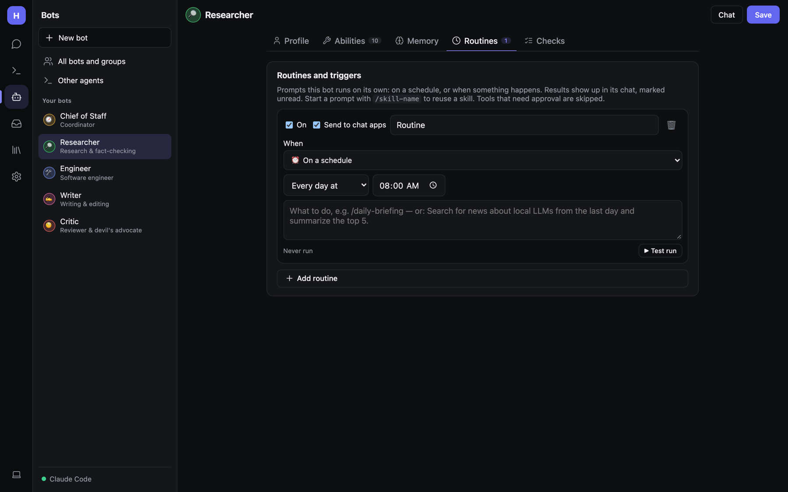

# Routines and triggers

A **routine** is a prompt a bot runs on its own: every morning, when a webhook arrives, when a file appears, when a
new email comes in… The result lands in that bot's chat, marked unread, with whatever triggered it attached.



## Making a routine

1. **Bots → (a bot) → Edit → Routines → + Add routine**.
2. Give it a **name**, and leave **On** ticked.
3. Tick **Send to chat apps** if you also want the result in Telegram, Discord, Slack, etc.
4. Pick **When** (the trigger) and fill in its details.
5. Write what to do in the prompt box, for example *Search for news about local LLMs from the last day and
   summarize the top 5*. A prompt can also be just a skill: `/daily-briefing`.
6. **Save** the bot. Then **▶ Test run** (or **Check now**) fires it once so you can see the result.

Tools that need your approval are **skipped** when a routine runs, because nobody is there to say yes. Allow them on
the [Permissions](Admin-Security-and-Permissions.md) page if a routine really needs them.

## Triggers

| Trigger | Fires when | Settings | Where it works |
|---|---|---|---|
| ⏰ **On a schedule** | A time comes round | *Every day at*, *Weekdays at*, *Every week on*, *Every … minutes* | Everywhere |
| 🪝 **Webhook** | Something POSTs to the routine's URL | URL + secret (shown after you save) | Web host; desktop only from the same computer |
| 📁 **Folder** | A file matching a pattern is added or changed | Folder, pattern | Desktop / web host with local access |
| 📰 **Feed** | A new item appears in an RSS/Atom feed | Feed URL, *check every N min* | Everywhere |
| 🌐 **Page change** | A web page's readable text changes | Page URL, *check every N min* | Everywhere |
| 📊 **A Google Sheet changes** | Rows are added or edited | Spreadsheet, optional range, interval | Needs [Google](Google-Microsoft-and-Email.md) |
| 📧 **New email arrives** | New Gmail messages match a search | Gmail search (e.g. `from:boss is:unread`) | Needs Gmail |
| 📅 **A calendar event is coming up** | N minutes before each event | Minutes before, interval | Needs Calendar |

What the bot receives with each trigger:

- **Webhook**: the request body (JSON, text or form).
- **Folder**: new and changed files; PDF, text and code are read and passed along.
- **Feed / Page change**: the new items, or a diff of what changed. The first check only records a baseline, so you
  only hear about *new* things.
- **Sheet**: new and edited rows, with the header row. Example: *"For each new lead, research the company and fill in
  column F."*
- **Email**: sender, subject and text. The first check only notes what's already there.
- **Calendar**: the event's title, time, attendees and notes — good for meeting prep.

## Webhooks in detail

After saving, the routine shows its URL with **Copy** and **New secret** buttons. Call it like this:

```bash
curl -X POST "http://your-hearth:5290/hooks/ROUTINE_ID?token=SECRET" \
     -H "Content-Type: application/json" \
     -d '{"event":"deploy finished","status":"ok"}'
```

or send the secret in a header instead of the URL: `X-Hearth-Token: SECRET`. A wrong or missing secret gets
**403**. Webhooks are not behind the web password, so the secret is what protects them; use **New secret** if one
leaks.

Works with GitHub webhooks, Home Assistant automations, IFTTT/Zapier, cron jobs and scripts. The desktop app only
accepts webhooks from the same computer; to receive them from other machines, run the
[web host](Admin-Installation-and-Hosting.md).

## When routines run

Triggers run while Hearth is running. The web host and the background service run them whenever the server is up;
the desktop app only while it's open. For dependable routines, install Hearth
[as a service or in Docker](Admin-Installation-and-Hosting.md).

Failed routines and triggers show under **Needs you** on the [Inbox overview](Inbox-and-Tasks.md).

## Related

- [Daily](Daily.md): the built-in morning brief, check-ins and heartbeat, which are ready-made routines.
- [Tasks](Inbox-and-Tasks.md#tasks): for long jobs that take many steps, rather than one prompt.
