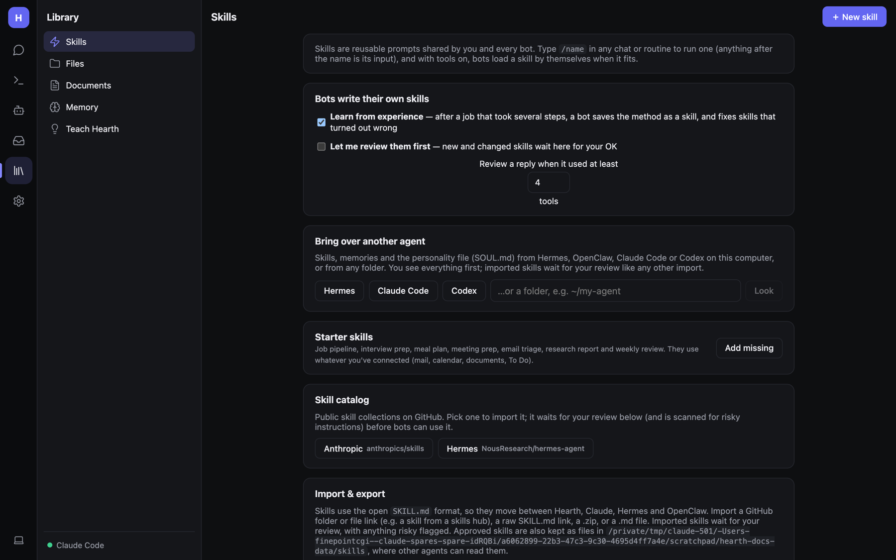

# Skills and teaching by showing

A **skill** is a reusable set of instructions, shared by you and every bot. Type `/name` in any chat or routine to
run one (anything after the name is its input), and with tools on, bots load a skill themselves when it fits.

Open **Library → Skills**.

## Using skills

- Type `/` at the start of a message to pick a skill: `/summarize <your notes>`.
- In a routine, the prompt can be just a skill: `/triage` for a webhook routine.
- With **Tools** on, bots see the list of skills and call `use_skill` when one fits.

## Making a skill

There are four ways:

1. **＋ New skill** on the Skills page: give it a `/name`, an icon, a description, and the instructions.
2. **From a message you sent**: click ⚡ under it to save that prompt as a skill.
3. **From a reply**: click ⚡ **Save as skill** under a good answer to save *how it was done*, step by step.
4. **Teach by showing**: record yourself doing it in a browser (below).

**Templates** at the bottom of the page add ready-made skills such as *summarize*, *action-items*, *proofread*,
*explain-code*, *translate*, *eli5*, *daily-briefing* and *triage*. **＋ Add all templates** adds the lot.
**Starter skills → Add missing** adds job-pipeline, interview prep, meal plan, meeting prep, email triage, research
report and weekly review; they use whatever you've connected (mail, calendar, documents, To Do).

## Bots write their own skills

With **Learn from experience** on (the default), after a job that took several tool calls, Hearth asks the model
whether the method is worth keeping. If so it saves it as a skill, or fixes the skill it used if the steps turned out
wrong. Bots can also do this themselves with `save_skill` and `improve_skill`.

- Each skill shows who wrote it and how often it's been used.
- Every change keeps the previous version: **↶** undoes it.
- **Let me review them first** — new and changed skills wait under **Waiting for your OK**, where you can **Approve**,
  **Edit**, or **Keep the old version**.
- **Review a reply when it used at least N tools** sets how much work counts as "several steps".
- **Skills that need a look** flags skills that keep getting 👎 or go unused: **It's fine**, **Keep** or **Delete**.

The [Permissions](Admin-Security-and-Permissions.md) page has a **Skills** row to control whether bots may write and
improve skills.

## Teach by showing

Record a task in a browser once and Hearth turns it into a skill.

1. **Skills → Teach by showing**. Pick a browser: the **Shared browser** or a bot's own.
2. Click **● Start recording**. A browser window opens on the computer running Hearth.
3. Do the task once. Hearth records clicks, typed text, choices, Enter and page changes. **Passwords are never
   recorded.**
4. Click **■ Stop recording**.
5. Remove any steps that were mistakes, then name the skill.

Hearth uses your model to turn specific values into placeholders (or writes a plain step list if no model is
available). Bots can then run it with `use_skill`, or you can type `/skill-name`.

## Portable skills (SKILL.md)

Skills use the open `SKILL.md` format (frontmatter with `name` and `description`, then Markdown instructions, plus any
bundled files), the same one Claude, Hermes and OpenClaw use.

**Import & export**:

- Paste a GitHub folder or file link (one skill or a folder of skills), a raw `SKILL.md` link, or a `.zip` link.
- Or **Upload .md or .zip**.
- **⬇ Export all (.zip)** downloads every skill.

Imported skills wait for your review. The import scan flags risky content: download-and-run commands, hidden base64,
sending keys somewhere, "ignore previous instructions", invisible characters, and bundled scripts.

Approved skills are also kept as files in the `skills` folder inside Hearth's data folder, where other agents can
read them.

**Skill catalog** offers public collections on GitHub (e.g. *Anthropic* `anthropics/skills`, *Hermes*
`NousResearch/hermes-agent`). Pick one to import it; it's scanned and waits for your review like any other import.

**Bring over another agent** imports skills, memories and the personality file (`SOUL.md`) from Hermes, OpenClaw,
Claude Code or Codex on this computer, or from any folder. You see everything first.
