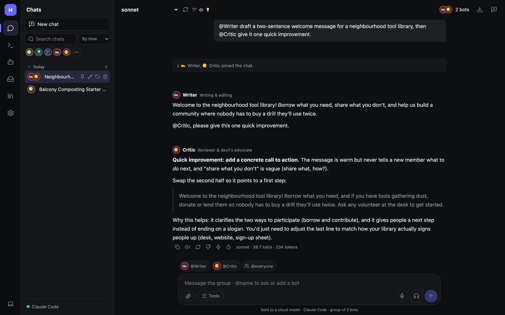
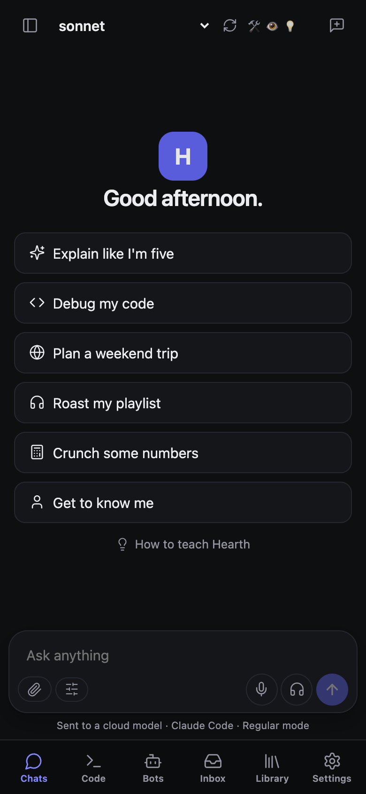

# Tour of the interface

Hearth looks the same in a browser, the desktop window and the phone apps.

## The three columns

1. **The rail** (far left): the six places in Hearth. The red badge on **Inbox** means something is waiting for you.
2. **The side panel**: what's in the place you're in, for example your list of chats, your bots, or the settings
   pages.
3. **The main area**: the page itself.

At the bottom of the side panel, a dot shows the active model server: **green** when it answers, **red** when it
can't be reached. Click it to open the model settings.

## The six places

| Rail icon | Place | What's there |
|---|---|---|
| 💬 | **Chats** | New chat, search, your chats grouped by time, person or topic; your bots as avatars for a quick 1:1 chat |
| `>_` | **Code** | Coding sessions in a project folder ([Code sessions](Code-Sessions.md)) |
| 🤖 | **Bots** | Your bots, groups, and **Other agents** like Claude Code or Codex ([Bots](Bots.md), [Other agents](Other-Agents.md)) |
| 📥 | **Inbox** | **Overview** (what needs you today), **Tasks**, and **Usage and cost** ([Inbox and tasks](Inbox-and-Tasks.md)) |
| 📚 | **Library** | **Skills**, **Files**, **Documents**, **Memory**, **Teach Hearth** |
| ⚙️ | **Settings** | **General and models**, **Connections**, **Permissions**, **Tools and MCP**, **Backup and restore**, **Computer** |

The laptop icon at the very bottom of the rail switches between light and dark theme.

## On a phone

On a narrow screen the rail moves to a tab bar at the bottom (**Chats, Code, Bots, Inbox, Library, Settings**), and
the side panel opens from the ☰ button at the top left. Everything else works the same. See
[Phone and notifications](Phone-and-Notifications.md) to install it as an app.

## The chat header

Along the top of a chat:

- **Model picker** (e.g. *sonnet*): the model for this chat. The small icons next to it show what the model can do:
  🛠 tool calling, 👁 images, 💡 reasoning. The ↻ button refreshes the list from the server.
- **Who's in the chat** (top right): the bot, or the bots in a group (e.g. *2 bots*). To bring another bot in, just
  `@mention` it in your message.
- **Copy chat as Markdown** (the download icon) and **New chat**.

## Keyboard

| Keys | Does |
|---|---|
| Enter | Send |
| Shift+Enter | New line |
| `/` at the start | Pick a skill (`/summarize`, `/imagine`…) |
| `@` | Mention a bot (`@Writer`, `@everyone`) |
