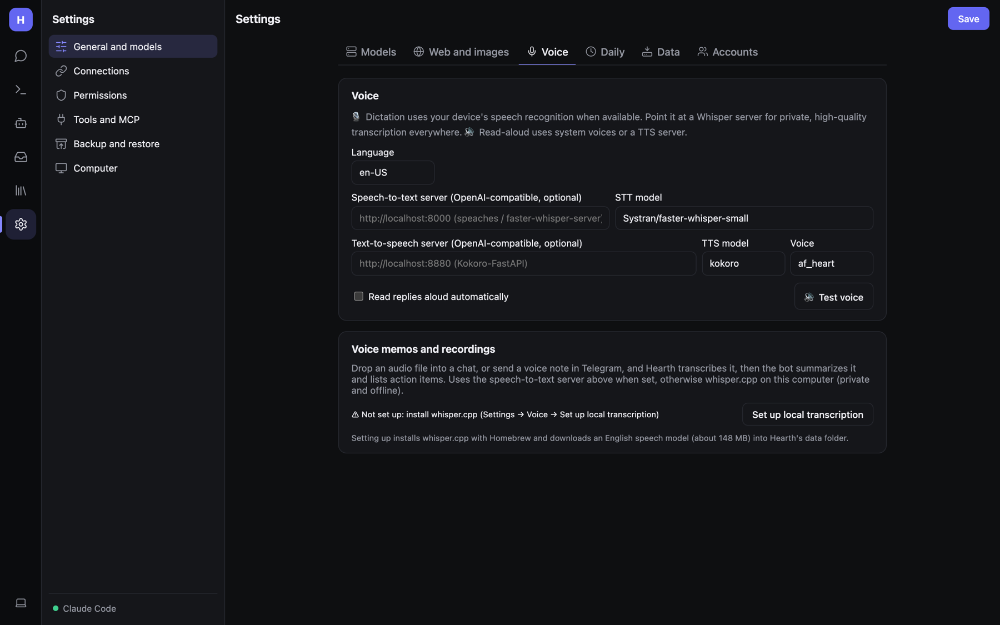
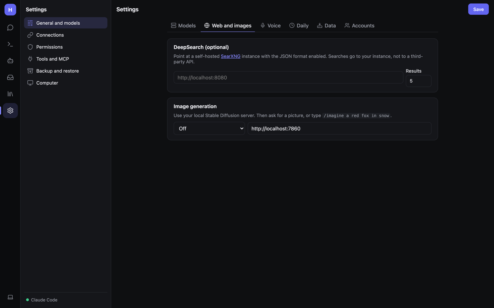

# Voice and images

## Voice



### Dictation (🎙)

Click the microphone in the message box and speak. In the phone/desktop apps this uses on-device recognition; in a
browser it uses the browser's speech recognition. For private, high-quality transcription everywhere, set a
speech-to-text server (below).

### Read aloud (🔊)

Click 🔊 under any reply. Uses your system's voices, or a text-to-speech server. **Read replies aloud
automatically** speaks every reply.

### Live conversation (🎧)

The headphones button next to the mic starts a hands-free conversation: it listens, notices when you stop talking,
answers out loud, and listens again. Tap the circle to interrupt; **End** to hang up. With a speech-to-text server it
records and transcribes; otherwise it uses the browser's recognition.

### Voice settings

**Settings → General and models → Voice**:

| Setting | What to enter |
|---|---|
| **Language** | The language you speak. |
| **Speech-to-text server** | An OpenAI-compatible Whisper server, e.g. [speaches](https://github.com/speaches-ai/speaches): `http://localhost:8000` |
| **STT model** | The model name on that server. |
| **Text-to-speech server** | An OpenAI-compatible TTS server, e.g. Kokoro-FastAPI: `http://localhost:8880` |
| **TTS model**, **Voice** | Model and voice name on that server. **🔊 Test voice** plays a sample. |

Fully local voices with Docker:

```bash
docker compose --profile voice up -d
```

then set `http://speaches:8000` (speech-to-text) and `http://kokoro:8880` (text-to-speech). Outside Docker, use
`localhost` and the ports you published.

### Voice memos and recordings

Drop an audio file into a chat, or send a voice note in Telegram, and Hearth transcribes it; the bot then summarizes
it and lists action items. It uses the speech-to-text server above if set, otherwise whisper.cpp on this computer
(private and offline). **Set up local transcription** installs whisper.cpp with Homebrew and downloads an English
model (about 148 MB) into Hearth's data folder.

## Images

### Sending images

Attach a picture with 📎 and ask about it. This needs a vision model, such as `gemma3`, `qwen2.5vl`, `llava`,
`llama3.2-vision`, or a Claude/OpenAI model. The model picker shows 👁 for models that understand images. Images are
shrunk on your device before sending.

### Generating images



**Settings → General and models → Web and images → Image generation** connects your own Stable Diffusion server:

- **AUTOMATIC1111 / Forge** — start it with `--api` (default port 7860).
- **ComfyUI** — default port 8188; pick a checkpoint.

Enter the address, click **Test & list models**, choose a model, and optionally set **Width**, **Height**, **Steps**,
**CFG** and a **Negative prompt**.

Then ask for a picture in a chat, or type:

```
/imagine a lighthouse at dusk, oil painting
```

Bots need the **Images** ability to generate pictures themselves. Generated images show up in
[Library → Files](Documents-and-Files.md#files).
